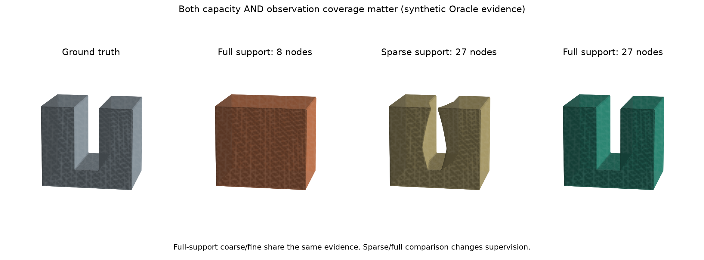

# 局部可表示性：已运行的机制冒烟实验

2026-10-20。本目录是**CPU、解析合成证据、有限约束诊断**。不是RGB重建，不是NeuS2训练，不是3060显存验证，也没有证明论文新颖性。输入精确表面/法线和额外向内探针，强于GT pose + GT mask。

> **同日后续：现已新增合成RGB局部接口。**下面原章节保留E0机制实验；新增E1接口使用SIFT三角化估计表面而非GT表面，仍使用GT相机/Mask与已知外壳。参见[RGB实际结果](../../research/2026-10-20_RGB_INTERFACE_RESULTS.md)及[完整重放命令](RGB_RUN.md)。它没有证明真实输入、同预算优势或完整对象重建。

## 已获得的证据

| 检查 | 实际结果 | 可以说明什么 |
|---|---|---|
| 平面、窄缝、同点矛盾、第三层窄缝，12种子×4类 | 共48例完成；插值、梯度、嵌套性、求解后残差检查通过 | 在所构造的3D轴对齐场景中，分支与数学预期一致 |
| 两层失败、第三层成功 | 8/27节点最小违例约3，125节点为0 | 两层失败不能判输入错误 |
| 任意LP可行解，重新采同一解析表面 | 点间可能严重违例 | 可行性诊断不能代替最终拟合 |
| 同最小违例下最小网格梯度能量 | 窄缝重采样违例均值11.08→0.77，但最大仍2.79 | 普通稳定化有帮助，稀疏覆盖问题仍在 |
| 相同完整覆盖证据：8节点→27节点 | 空域误占据100%→0%；实体探针保留100%→100%；41条中心直通路径0/41→41/41 | 该构造下确有表示能力瓶颈，增加自由度可解除 |
| 去掉向内探针和法线，仅表面+正空域余量 | 粗层违例0.95，细层0 | 核心诊断不完全依赖额外内部Oracle探针 |
| 再把正空域余量设为0 | 粗细均可行 | 无符号/方向余量时零场可能让判据失效 |

`eta`是代码中固定单位归一化后的最小违例，不是毫米精度，不同约束配置的数值不能当同一物理误差比较。

## 最有用的图与数据



四列：真值、完整覆盖8节点、稀疏覆盖27节点、完整覆盖27节点。**第二/四列监督相同，比较容量；第三/四列监督不同，比较覆盖。**稀疏覆盖版仍有扭曲表面，不能只凭少量误占据说几何恢复成功。外壳/底座是各组共享的已知解析结构，只有局部节点来自拟合。

- [完整覆盖对照指标](results/coverage_v1/metrics.csv)：同一ROI采样150000点，随机种子1234；空隙ROI为`0.39<x<0.61`，实体保留ROI为`x<0.36或x>0.64`，公共范围`0.05<x<0.95, 0.32<y<0.85, 0.15<z<0.85`。它们是场占据探针指标，不是Mesh Chamfer/F-score。
- [三类诊断及反例](results/smoke_v2/diagnostics.csv)、[诊断图](results/smoke_v2/diagnostics.png)、[稳定化失败与改善](results/smoke_v2/stability.png)。重采样只是同一解析几何上的新点，不是独立图像或测试对象。
- [约束消融](results/constraint_ablation_v1/ablation.csv)：分离正余量、法线、内部探针各自的影响。
- [恢复Mesh](results/coverage_v1/full_3.obj)、[同监督粗Mesh](results/coverage_v1/full_2.obj)、[真值](results/coverage_v1/ground_truth.obj)。坐标均为归一化无量纲单位，不能称毫米精度。
- `smoke_v1`保留第一轮失败，`smoke_v2`保留稳定化后结果；`coverage_v1`、`constraint_ablation_v1`含当次源文件快照和证据，禁止覆盖旧结果。

中心直通路径指标固定`x=0.5`、41个`z∈[0.15,0.85]`，逐条检查151个`y∈[0.32,0.93]`样点全为空。它比只报占据体积多了一项贯穿检查，但仍只是有限直线路径代理，**不是连续拓扑证明、也不是全缝宽度恢复率**。稀疏覆盖版也能通过这些中心线，但缝壁仍扭曲，必须同时看Mesh和其他指标。

`scheduler.csv`是特意排列的压力/分支回归测试：未收敛平面误差大、矛盾块不值得盲目加密。其块顺序和初始化人为构造，**不能用其中4/4对0/4做论文性能柱状图**；它没有证明在真实候选块、等时间预算上优于残差或均匀细化。

## 实现要点

`run_smoke.py`：稀疏三线性插值/法向导数矩阵 → SciPy HiGHS最小违例LP → 决策 → 可选最小改动或最小梯度能量解 → 同分辨率CPU Marching Cubes →原始CSV/OBJ/图。`run_coverage.py`单列覆盖消融；`run_constraint_ablation.py`单列约束退化检查。

节点变量显式允许负数；粗细网格嵌套；求解成功后重新计算实际不等式余量。诊断中没有固定全局边界或真实粗网络，这是接回RGB管线时必须新增的部分。小CPU体积统一提取不是流式GPU实现。

## 本机直接复现

原实验机器已建立独立环境；新机器须按下面的安装步骤建立，虚拟环境不随 Git 同步。以普通 PowerShell 从仓库根目录运行：

```powershell
# 当前目录应包含 AGENTS.md 与 experiments/，不依赖另一台机器的盘符。
. .\.venv-gap-smoke\Scripts\Activate.ps1
$env:MPLCONFIGDIR = Join-Path (Get-Location) '.work-tmp\matplotlib'
$runStamp = Get-Date -Format 'yyyyMMdd-HHmmss'
python .\experiments\gap_representability\run_smoke.py --output ".\experiments\gap_representability\results\smoke-$runStamp"
python .\experiments\gap_representability\run_coverage.py --output ".\experiments\gap_representability\results\coverage-$runStamp"
python .\experiments\gap_representability\run_constraint_ablation.py --output ".\experiments\gap_representability\results\ablation-$runStamp"
deactivate
```

若本机终端策略不允许激活，可直接用`& '.\.venv-gap-smoke\Scripts\python.exe'`替换上面的`python`；无需改系统执行策略。程序输出目录非空会停止，以保护原始记录。

在另一台安装了常规Python3.12的Windows机器，从项目目录首次设置：

```powershell
py -3.12 -m venv .venv-gap-smoke
. .\.venv-gap-smoke\Scripts\Activate.ps1
python -m pip install -r .\experiments\gap_representability\requirements.lock.txt
python .\experiments\gap_representability\run_smoke.py --output .\experiments\gap_representability\results\other-machine-smoke
python .\experiments\gap_representability\run_coverage.py --output .\experiments\gap_representability\results\other-machine-coverage
deactivate
```

`requirements.lock.txt`记录本轮实际版本，`requirements.txt`给出宽松兼容范围。网络无法连接PyPI时，可为安装命令显式加`--index-url https://pypi.tuna.tsinghua.edu.cn/simple`；本轮使用该镜像。已安装环境的实验运行不需要网络。

## 资源与尚缺证据

`smoke_v2`一次运行约5.50秒、CPU进程峰值工作集328.6MiB；`coverage_v1`约4.33秒、290.0MiB。时间从主程序开始计，不含安装/模块导入；不是严谨速度基准。显存字段为“不适用”，设备快照不当峰值。

E0 本身没有 RGB 输入；同日 E1 已接通合成 RGB 的稀疏表面前端和局部拟合，见文首更新。整个项目仍没有：完整物体 RGB 闭环、位姿/Mask 误差实验、真实候选块预算比较、全局场拼接、流式提取、真实细杆厚度/Chamfer/F-score/法线评价、完整阶段 GPU 峰值。

下一步按[一周执行计划](../../research/2026-10-20_WEEK_EXECUTION_PLAN.md)：先让真实图像生成可靠FREE与表面证据，再验证同监督、同容量/等时间下判据是否值得保留。基于今天结果，**值得继续小规模实验，但还不能定题或宣称方法有效于真实重建**。
