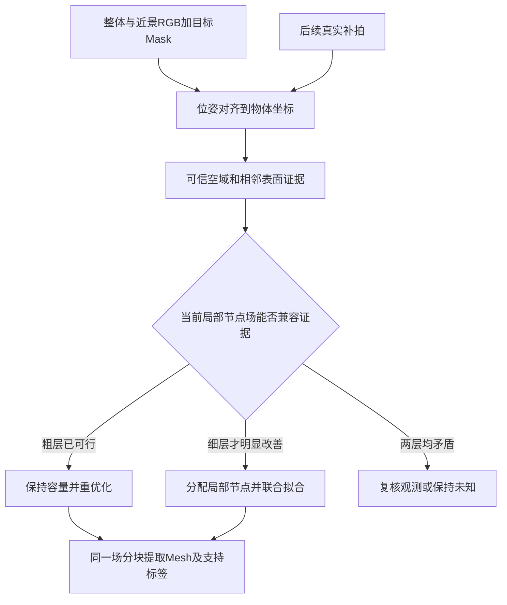

# 续研：用观测证据解除错误桥接的局部重建核心

日期：2026-10-19。状态：研究设计中；未实现、未运行重建、未实测显存。本文随调研逐批更新，保留判断依据。

> **2026-10-20后续实测：**有限约束CPU Oracle原型已跑通，历史“未实现”以[最新实验](../experiments/gap_representability/README.md)为补充。两项实测修正：粗细两层失败不一定证据矛盾（第三层可成功）；任意LP可行解在采样间隙可能失真（需稳定化与独立验证）。RGB管线、12GB全流程和同预算优势仍未验证，不升级为已定题。

## 检查点 1：接续已有工作

已读取项目研究档案、主调研矩阵、进度交接和 `2026-10-19_static_gap_core.md`。不重新把完整扫描器当作论文创新；当前优先对象为静置手办/刚性雕塑，拍摄有整体、过渡距离和局部近景，允许少量 Mask 修正。物体移动/翻面仍统一到相对位姿，但不把任意手持位姿求解作为本轮算法贡献。

本轮待回答：**如何区别缺少监督、场容量不足、位姿/Mask矛盾、Mesh提取漏缝，并据此只为真实可恢复的空隙增加局部自由度？**

计划与验收：

1. 核读本地 DG-Mesh 和最近的自由空间/自适应重建先例 → 明确哪些机制已经做过，不把 canonical space 当创新。
2. 收敛一个核心算法 → 给出观测量、细化触发、联合空域/实体约束、更新与导出规则，能够被同预算简单基线否定。
3. 保留一个论文候选 → 写摘要式表述、12GB资源算术和由用户执行的最小实验；所有实际峰值保持“未测”。

证据沿用主报告：`[P]`论文原文；`[C]`官方代码；`[I]`推断；`[H]`新假设；`[M]`本机测量（目前无）。前轮矩阵见 [主调研](./2026-10-19_mesh_research_audit.md)。前轮局部表示设计见 [静态间隙方案](./2026-10-19_static_gap_core.md)。

初步判断：全局粗 SDF + 局部残差网格有工程可行性，但“空域冲突越大就越多采样/细化”很可能只是已有残差自适应策略的实例。需要寻找更具体、可验证的结构性差异；**目前不能确认创新性**。

## 检查点 2：DG-Mesh 真正能借什么

已用 `pdftotext -layout` 实际读取本地 `papers/DYNAMIC GAUSSIANS MESH.pdf` 第4–7页，并与既有全文提取核对。该文为 ICLR 2025，不能误写成静态雕塑扫描论文。

- [P] §3.1：canonical Gaussians + 学习的时空形变；输入已有相机参数。
- [P] §3.2：Gaussians作为带法线点云，经DPSR与可微MC得到Mesh，带Laplacian正则。
- [P] §3.3：通过Mesh面中心增删/锚定Gaussians，再以双向形变及cycle consistency更新canonical表示。
- [I] 对静态刚体只需 `x_camera = R_i x_object + t_i`。其统一空间思想适用，但无需为不变形手办训练非刚性正反形变网络。
- [I] 其加密主要解决表面点分布和时序对应；已读机制没有直接给出“可见窄空隙的占据冲突→增加局部几何自由度→删除误桥”的判定。DPSR或Mesh的均匀分辨率/平滑也不能被当作不粘连保证。

来源：[DG-Mesh作者项目](https://www.liuisabella.com/DG-Mesh/)、[官方代码](https://github.com/Isabella98Liu/DG-Mesh)。正式状态与原始硬件见原矩阵，仍无12GB峰值测量。

## 检查点 3：新增反创新证据

- [P，官方论文检索片段] [SSP，WACV 2024，§3.3](https://openaccess.thecvf.com/content/WACV2024/papers/Zhu_SSP_Semi-Signed_Prioritized_Neural_Fitting_for_Surface_Reconstruction_From_Unoriented_WACV_2024_paper.pdf)已根据每体素滑动平均损失做两级采样，同时含自由空间/符号监督。输入是无定向点云，不是本项目RGB，但足以否定“局部冲突大就多采点”作为宽泛新意。全文直链本轮web访问403，继续尝试获取，不把检索片段当全文已读。
- [P，已读作者全文§3.3] [CASA-SDF，Neurocomputing 2026](https://arxiv.org/html/2607.13492v1)按法线变化估计曲率，局部调节SDF→密度变换锐度，并退火不可靠先验。这里“增加带宽”不等于增加网格节点，不能混为一谈；泛泛的自适应薄结构恢复已不新。
- [P，出版方摘要] [GSNSR，EGSR 2026 Symposium Track](https://diglib.eg.org/items/6869b7a4-d955-48f9-974a-fe84a18b4f43)明确已有confidence-aware free-space loss。当前两域名正文入口均失败，尚不能逐式排除重合。

据此，候选核心进一步收窄为：**观测约束的局部可表示性检验，驱动有界的空间细化**。不是仅看当前损失，而是估计在当前单元自由度下，是否存在一个场能同时满足可靠空域与相邻表面约束；若已有容量可满足，优先重新优化；若粗层不能满足而细层可以，才增加节点。它是否比普通残差细化值得，必须由实验决定。

## 检查点 4：补齐 GSNSR 与 SSP 全文

本次通过公开出版页面找到了PDF实际下载链接，已保存 `evidence/gsnsr.pdf`、`gsnsr.txt`、`gsnsr_page_20261019.html`，并取得 `evidence/ssp.pdf`、`ssp.txt` 和 `evidence/code/ssp_fitting.py`。只读取资料，未执行下载代码。此前“全文未取得”记录是历史状态，此处更新。

**GSNSR，[P] §4.1–4.2、式(6)–(9)：**深度支持、局部一致性与深度梯度构成置信度；以3DGS预测表面之前的区间为自由空间，惩罚该区间的体渲染权重。该机制不同于直接检验局部离散场能否容纳可靠空隙与相邻表面，但“带置信度的自由空间监督”已明确被做过。§5.2承认错误深度即使降权仍可使表面内缩；§5.1仅报告RTX4090、300k步约8小时，未核到显存峰值。不是12GB可运行证据。[出版方全文](https://diglib.eg.org/bitstreams/16e092e4-95f4-4943-98b5-d6422220268e/download)。

**SSP，[P] §3.3式(9)–(10)：**已确认按局部损失滑动平均分配体素采样概率；§4报告2080Ti，未核到完整峰值。输入无定向点云、外部符号区与不确定区分开拟合。[C] 官方仓库有空间雕刻和拟合入口，已下载入口静态阅读；没有在本机运行，不能推断12GB RGB扫描能力。[官方代码](https://github.com/Runsong123/SSP)。

**进一步的否定证据，[P，出版方摘要]：**[Topology Preserving Surface Extraction Using Adaptive Subdivision，SGP 2004](https://diglib.eg.org/items/13766115-717e-4d35-94d3-3bc14f6be551)早已有局部几何条件驱动的自适应细分及拓扑保持提取。因此“检测局部拓扑风险再细分”也不能直接当新贡献。区别必须落在**从含噪RGB观测建立约束、判断当前可训练表示的兼容性、而非仅提取一个已知正确场**；这一窄区别仍未证明新颖。

## 1. 唯一建议保留的课题

**工作题目：《观测约束可表示性驱动的刚体细结构局部重建》**。

要研究的不是“能否把整个人偶变成高分辨率体素”，而是：

> 在有限几何自由度下，如何判断一组真实观测要求的“空气通道 + 邻接表面”是否能被当前局部表示同时容纳，并只为需要的区域增加自由度？

该题是前版“间隙约束驱动局部残差SDF”的进一步具体化，**不是另开一个候选方向**。当前把位姿不确定性处理作为输入可靠性控制，把12GB作为实验条件；不同时宣称三项独立创新。



### 拟议摘要（研究计划口吻，不能当作已有实验结论）

多视图表面重建在具有窄缝、孔洞与细杆的刚体上容易产生错误桥接。单纯增加采样或提高导出分辨率，无法区分观测不足、几何表示不足与提取误差，且全局细化带来较大的存储开销。我们拟研究一种由观测约束可表示性驱动的局部重建方法：将多视角RGB中可靠的自由空间与表面证据对齐到统一物体坐标系，在局部显式SDF中检验两类约束的联合兼容性；仅对粗层无法满足、细层可以改善的区域增加几何自由度，并通过表面位置与法线约束限制误雕刻。方法保留可追溯的观测支持，新视角加入后重新评价局部约束与几何。通过有界块驻留和分阶段处理，拟在RTX3060 12GB上验证间隙恢复、细杆厚度保持和显式Mesh导出的完整闭环。实验将比较同监督、同容量和同时间的简单细化方法，以检验该判据是否具有独立价值。

### 为什么这个核心比“误差大就加体素”更具体

当前损失大可能只是还没优化好。对局部可训练标量网格，在固定观测点下，其插值值对节点参数是线性的。因此可先用一个小型约束问题估计**当前分辨率所能达到的最小违例**，再决定重新优化还是细化。这提供了能被验证或否定的分支决策，而不是把每个高损失块都放大。

“线性规划”“误差估计”“自适应网格”本身都是已有技术。本文只提出它们针对RGB细缝证据的具体用法假设，不宣称新发明这些工具。

## 2. Canonical space 在这里的正确职责

对单个静态刚体定义固定物体坐标系，`T_i = T_camera_from_object`：

```text
x_camera = R_i x_object + t_i
pixel_i  = project(K_i, x_camera)
```

所有表面点、自由空间约束、局部网格和覆盖记录都落在 `x_object`。静置物体可由静态场景SfM求位姿后固定一个object frame；物体移动时必须求相机—物体相对位姿。多段片段先对齐尺度与刚体变换；RGB-only没有天然毫米尺度，须尺寸参照或明确的评估对齐。

**坐标系只负责对齐，不会自行提高分辨率、填补未知面或解开误桥。**“canonical完整度”要另存观测支持：表面是否真正可见、是否多视一致、对应哪些图像、是否低置信/未观察。后续拍到背面，加入的是新约束及支持记录，覆盖和几何才随重优化更新。

## 3. 核心算法：从观测约束到有限自由度分配

### 3.1 只维护两类几何证据和未知标签

**空域证据 F：**可信的非目标背景像素束反投影到对象包围盒，形成无目标的视线区域；只使用真实可见背景。手、桌面遮挡、模糊边界与无法确定的像素为UNKNOWN。未知区域不雕刻。对含目标的射线，可用经多视图验证的MVS深度之前的区间作为较弱空域证据，不能沿射线一直刻穿物体。

**表面证据 S：**目标内RGB多视匹配/MVS得到的位置、法线、支持视图与误差容限，配合OBJECT轮廓命中和RGB/patch一致性。MVS是RGB推断，既不是传感器深度，也不是GT。没有缝壁表面支持时，只能约束“此处应为空”，不能声称已恢复正确壁厚。

位姿/分割误差先转换为保守投影安全带。首版直接使用重投影残差校准的安全带，无需先实现完整SE(3)后验。窄缝宽度小于两侧安全带之和时应拒绝强雕刻并提示补近景/改配准；不能通过更细体素创造信息。任意各向异性误差传播作为消融扩展，不作为第一贡献。

每个证据保留 `view_id / pixel或patch / pose_version / mask_version / confidence`。同一段高度相似帧不当成独立观测无限累加置信度。

普通Mask渲染损失已经包含“背景射线不应命中目标”的信息。因此这里显式整理FREE点并不创造新的监督信息，也不能直接算创新；必须给基础场相同Mask、FREE与表面证据后再比较。背景必须确实位于目标之后或该视线中目标不存在；前方非目标遮挡者不能提供穿透它的空域证据。

### 3.2 表示：全局粗场 + 可检验的局部标量场

复用NeuS2类后端产生全局 `f0`，约定外部为正。候选块内部用规则标量节点 `z` 的三线性插值 `g_h(x)=a_h(x)^T z` 表示局部几何；将 `f0` 在节点采样作为初值，再学习节点增量。

在核心区直接使用 `g_h`，外围固定过渡带使用：

```text
f(x) = (1-w_B(x))*f0(x) + w_B(x)*g_h(x)
```

`w_B` 在核心为1、块外为0，细缝必须位于核心区；边界匹配全局场。第一版一个带宽裕上下文的手部块，先比较32/64/128等嵌套分辨率，不先实现复杂稀疏八叉树优化器。后续才按同一规则选择多个非重叠核心块，含固定边界/邻域重优化。

**相对前版的必要修正：**前版 `f0(x)+w*r(x)` 保留一个任意非线性全局项，不能据此宣称局部场具有三线性表示上限。这里明确将局部替换为可检验的节点场，才能研究表示能力与细化；否则可表示性结论会与实际后端脱节。全局原场仍是对照，需检查局部替换本身有无损失。

这是局部隐式函数，不自动是真距离场。法线/Eikonal仅作拟合约束，提取使用零等值面。强平滑、补洞或只保留最大连通分量可能再次破坏细结构，不能默认使用。

### 3.3 小型可表示性检验：核心假设 [H]

在候选局部小窗Q内取有限可信空域点 `q`、表面点 `p` 和邻域边界条件。它们对应的插值矩阵分别为 `A_F、A_S、A_B`。对同一组观测和容限，在粗层h与嵌套细层h/2求：

```text
η*_h = min_{z,η≥0} η

subject to
    A_F z                    ≥ δ_F - η*u_F
    |A_S z|                  ≤ ε_S + η*u_S
    n_p^T ∇g_h(p)            ≥ γ_p - η*u_N
    |A_B z - f0(boundary)|   ≤ ε_B + η*u_B
```

绝对值拆成两个线性不等式；固定位置、法线、窗口与基函数后，这是小型线性规划。`u`为预先确定的单位/噪声归一化尺度，防止位置误差和梯度误差随意混在一起。`δ_F>0`是保守空域余量、`ε_S`是表面位置误差容限、`γ_p`只用于方向可靠的法线点，防止零场/退化零集被误判成功。可靠法线朝向由真实可见视角校验，不能从错误桥面反推为真。

必须比较 `δ_F=0` 与小正余量；余量不得大于观测能够支持的缝内净空。表面定位误差太大或余量太小时，检验可能几乎总可行，这是本方案真实失败风险，不能靠测试集调阈值隐藏。不能把所有训练点的硬约束当成无噪GT。

只在少量高冲突小窗求解，观测分批、矩阵稀疏，CPU执行；**不在256³所有节点上建立全局LP**。边界条件必须两层一致且允许粗解在细层精确插值，否则两层结果不可比。边界本身冲突时扩窗/回查粗场，不把所有不可行都解释成分辨率不足。

`η*_h`仅是这些有限线性条件在此表示内的最小违例。它不证明真实观测正确、全空间拓扑正确、完整SDF可行，也不证明含RGB/非线性正则的训练能达到同样结果。

低违例解可以作为局部几何初始化，随后仍需完整观测拟合；LP存在许多解，缺少表面观测时可能产生不真实曲面，不能直接把可行解当最终Mesh。粗层“可行”只说明这些线性必要条件不排除该容量，并不证明容量足够；粗层“不可行”也要先排除错误证据、错误容限和边界。加入正常梯度范围等额外条件能限制极陡退化场，但会引入新的容限假设，需单独消融，不能把Eikonal软正则说成硬距离保证。

### 3.4 一个能解释“加密为什么有必要”的例子 [I]

在**一个三线性单元内沿坐标轴方向**，场退化为一维线性函数。若相邻两侧表面点为a、b，中间空气点为q，且三点共用该轴向线段，则：

```text
g(a)=g(b)=0  ⇒  g(q)=0
```

因此同一粗单元不能同时满足两侧零面和中间严格正空域；加入中间节点、拆成多个单元后才可能满足。这说明某些细缝失败是自由度不足，不是继续加同类射线就能解决。

**限制：**此例仅适用于所述轴向/三线性条件；任意斜线在三线性场中可能是三次多项式，神经MLP也不受这一结论约束。不能泛化为“所有体素最多一个表面”，更不能拿它证明通用拓扑保证。实际3D判定由完整局部约束问题决定。

### 3.5 三种决策，而不是一律细化

| 证据与诊断 | 动作 | 避免的问题 |
|---|---|---|
| 当前场违反约束，但粗层已有低违例解 | 保持节点数，增加定向优化/改采样 | 把未收敛误当容量不足 |
| 粗层违例明显，细层下降，且独立视图支持同一空隙 | 为该局部增节点，联合重优化空域和相邻表面 | 全局盲目加密；曲率已经被抹平的误桥无法触发 |
| 两层均矛盾，或留出观测不支持改善 | 暂缓雕刻，检查Mask/位姿/表面先验或扩窗 | 拟合噪声、把手指削掉 |

细层更易过拟合，所以“违例下降”不是充分条件；需要与用于选择的观测分开的验证视图/patch。若验证参与参数选择，它就不是最终测试集，必须另留测试视角。

候选优先级可取 `(η*_h-η*_{h/2}) / 新增节点字节`，再乘观测支持门控。所有选块开销计入时间；它是可比较的启发式，不是预算内最优性证明。可靠空域候选直接从图像构建并与当前场求冲突，不能只在已有Mesh高曲率处选点，否则完全被填掉的洞可能永远没机会重建。

### 3.6 局部拟合与防误雕刻

优化节点时同时保留：FREE符号/余量、MVS表面及法线、OBJECT命中、RGB/patch一致性、过渡带一致性。先冻结全局与位姿，隔离这个模块；必要外观更新采用相同配置用于全部对照，避免冻结错误外观阻挡几何修正。

首轮关注正面可见的贯穿指缝。深凹槽内部缺少真实视角时，Mask不能提供正确槽底；没有内壁观测就保持低支持。为了使一个空域指标变好而删掉手指，会在实体召回/厚度/法线指标上判失败。

### 3.7 新观测与最终Mesh

新近景加入后：校准/配准→更新证据→重算受影响块判据→从当前解重优化；同时保留全数据重训对照。可以改旧结果，但不承诺训练轨迹单调改善，也不声称精确消除某一帧对共享网络的全部影响。

最终对同一个复合场提取Mesh。首版小物体可用统一细采样间距、分块查询和MC，控制工作区而接受时间增加。跨块统一坐标、等值面、边界采样和顶点去重；不能独立训练每块后直接焊接。**分块query不等于分块MC工作区。**

规模扩展时才采用已有的相容多分辨率提取/过渡单元方法；必须处理不同层级接缝。不能声称简单分块已经解决兵马俑全身的时间与总输出量。每面另存观察支持标签；有真实可见性且跨视一致才标为观察支持，单纯投影进Mask不算。未观察面可保留但标记为推断，也可输出开放观测Mesh；不能同时承诺无证据处水密和完全忠实扫描。

## 检查点 5：新增可用的显存数字，立即修正原先空缺

[P] [CASA-SDF作者全文§4.2](https://arxiv.org/html/2607.13492v1#S4.SS2)明确报告在RTX4090上的训练比较：基线峰值 **8.93 GB**、完整方法峰值 **9.97 GB**，单步0.226/0.247秒；240k步、1024 rays，先验离线预计算。这里沿用论文GB单位，不擅自改成GiB。**这是作者报告训练峰值，不是3060实测，也没有由此确认前处理、MC与纹理的完整流程峰值。** 未找到可核验的官方实现链接。相比“只知道4090卡型”，这是一项实质新增证据；原档案CASA-SDF的峰值未知应以本条为准。

本轮官方仓库实时核查还确认：DynaSurfGS仍标代码待发布；GPU-SDF主分支仍只有README与结果下载入口；不能将它们排进直接可运行的MVP。NeuS2与NeRF2Mesh有训练/导出入口，但本机未运行。

## 4. 与最接近工作的逐机制比较

完整13项输入/位姿/Mask/canonical/几何/Mesh/细结构/遮挡/代码/资源矩阵保留在 [主调研](./2026-10-19_mesh_research_audit.md#相关工作矩阵)。下表只补本轮改变结论的近邻；`NR`是本轮未核到，不是证明其从未报告。W=静态共同坐标，O=对象相对坐标。

| 工作/证据 | 输入/位姿 | Mask | canonical | 表示/显式Mesh | 薄结构处理 | 遮挡边界 | 作者峰值/硬件 | 代码状态 |
|---|---|---|---|---|---|---|---|---|
| GSNSR，EGSR2026 [P]全文 | posed RGB、预训练3DGS、COLMAP点 | 置信评估用前景Mask | W | hash SDF + GS特征；Mesh | 可信伪深度空域与局部特征 | 软权重可能仍误刻；非手物三态方案 | 峰值NR；4090，约8h/scene | 官方实现本轮未找到；不称未开源已证实 |
| SSP，WACV2024 [P/C] | **无定向点云**，非RGB端到端 | 不适用 | 输入点云坐标 | 神经SDF；Mesh | 按区域损失采样、渐进PE、已知空域符号 | 不确定符号区域；不是图像遮挡处理 | 峰值NR；2080Ti | [官方实现](https://github.com/Runsong123/SSP)已发布，入口已静态读 |
| CASA-SDF，Neurocomputing2026 [P] | posed RGB + 单目预测先验 | 不以对象交互Mask为主 | W | SDF；MC Mesh | 不可靠先验退火、曲率调密度锐度 | 没有直接的手/桌面目标分离模块 | **训练峰值9.97GB**；4090；非全流程口径 | 官方实现本轮未找到 |
| NeRF2Mesh，ICCV2023 [P/C] | posed RGB/COLMAP | 官方实现支持去背景 | W | NeRF/SDF初始Mesh→显式细化纹理Mesh | §3.2按反投影渲染误差选择面细分/简化 | 不是自由刚体遮挡融合 | 训练峰值NR；V100 16GB是硬件；Table3为资产渲染显存 | [代码](https://github.com/ashawkey/nerf2mesh)有两阶段流程；本轮PDF已保存并读方法节 |

### 三个候选思想的结论

| 候选 | 已经做过的部分 | 本轮仍可研究的窄问题 | 判断 |
|---|---|---|---|
| 2. 位姿不确定性canonical融合 | BundleSDF/In-Hand的统一对象场；ICON/PoRF/ManifoldNeuS的位姿几何优化；UA-Pose的覆盖/筛姿态；概率轮廓对标定噪声处理 | 有限误差下哪些缝内证据可用，以及安全带何时导致信息耗尽 | 不推荐作为首版主创新；泛泛置信融合不新 |
| 4. 拓扑风险采样/局部细化 | DebSDF/GPU-SDF/SSP的重要性采样；CASA-SDF局部锐度；ExMesh/NeRF2Mesh的自适应表面；历史拓扑保持提取 | 当前局部表示能否同时满足**观测要求**的空域与表面，并据最小可达违例选细化 | 唯一保留候选；尚不能确认新颖性，不承诺拓扑保证 |
| 5. 固定12GB稀疏分块流式Mesh | SparseFlex、哈希场、Neuralangelo分块MC及经典稀疏体融合 | 在明确工作集上完成输入到Mesh及细缝验证，计量各阶段峰值 | 作为约束与实现贡献；12GB数字本身不是学术创新 |

**目前不能确认**有一篇已完整覆盖这里提出的局部可表示性判据，也**目前不能确认**该判据具有足够新颖性。此次补齐GSNSR、SSP、NeRF2Mesh全文只缩小了具体等价风险，不能代表穷尽整个领域。经典自适应有限元/约束细化、区间隐式重建与同类体素方法仍须在正式开题前进一步逐式比较。

补充全文核查：[NeRF2Mesh §3.2](https://openaccess.thecvf.com/content/ICCV2023/papers/Tang_Delicate_Textured_Mesh_Recovery_from_NeRF_via_Adaptive_Surface_Refinement_ICCV_2023_paper.pdf)积累反投影到面的图像误差，采用95%/50%分位阈值安排细分/简化。这与“测当前训练残差”相近，未在该节看到对新观测约束求最小可达违例。其Table3几百MB数字测的是导出资产渲染，**不能被误读为训练只需几百MB**。全文已保存为 `evidence/nerf2mesh.pdf/.txt`。

## 5. RTX3060 12GB：明确能算出的量与不能承诺的量

### 5.1 已有事实

| 项目 | 数值或限制 | 证据性质 |
|---|---|---|
| MILo base / dense | 作者约10GB / 最高约17GB训练用量 | [P]前轮已读§6.1；不是全流程统一峰值 |
| CASA-SDF | 作者训练峰值9.97GB | [P]本轮新核§4.2；非3060实测 |
| Neuralangelo | 官方默认≥24GB；12GB降低hash配置，可能降质量 | [C]README；不是本机成功记录 |
| NeuS2的1024³整块MC | 索引工作区12GiB，另有单份float网格4GiB | [C+I]本轮复核 `neus2_extract.cu:799`；两项16GiB已超本卡，不含模型/输出 |
| 所提方法 | 完整阶段峰值**未测** | [H]只有设计，没有[M]结果 |

NeuS2当前读取的 `scripts/run.py` 训练后会直接MC并渲染训练视角；省略 `--save_mesh` 不能假定跳过训练分支的MC。命令验证应从256开始，不能默认512足够，更不能直接1024。原入口也不是现成的分阶段内存隔离器。

### 5.2 局部标量场的存储算术 [I]

以下N为每轴**节点数**，不含halo、临时区和其他模型；FP32参数+梯度+Adam两份状态共16字节/节点：

| N | 参数单份 | 四份状态 |
|---:|---:|---:|
| 128 | 8MiB | 32MiB |
| 192 | 27MiB | 108MiB |
| 256 | 64MiB | 256MiB |

这只是局部场的可控成本，不能当训练峰值。导出若按同一源码工作区计算，每个128³采样块的索引+标量约32MiB；实际有halo、顶点/面、扫描缓存，可能远高于此。必须及时移走输出，不能让所有块Mesh仍驻GPU。

同一2m包围盒用512节点/轴时，间距约3.91mm；10cm手部用256节点/轴约0.392mm。它说明局部空间分配的意义，**不意味着重建精度已达到0.392mm**。分辨率、成像、位姿和优化误差都限制最终精度。

### 5.3 有界闭环的工程设定 [H]

- 分割、SfM/MVS、全局训练、局部细化、Mesh提取、纹理依次运行；中间结果落盘。不得同时常驻SAM、深度网络和重建网络。
- 原图保留高分辨率，CPU/磁盘缓存；只上传少量patch/rays。下采样不能把待恢复缝直接抹掉。已有后端若没有有界图像缓存，必须修改loader或限制关键帧，并明确这一工程缺口。
- 首轮工作集目标：新增GPU占用≤`min(9GiB,运行前空闲显存−1.5GiB)`；只是留余量的计划，不是硬件隔离保证。CPU进程RAM目标≤20GiB，缓存与Mesh输出有上限。
- LP先限于小窗，例如4³或8³单元及其一层试分裂，稀疏矩阵在CPU，逐窗求解；候选数量和单窗证据数有上限。它可能耗时且无效，必须计入等时间对照。
- 活动局部场、必要邻域、观测批次和导出块有明确上限；其余节点/优化状态暂存CPU/磁盘。真正多块训练还需实现邻域条件和状态换入换出，**现有NeuS2不能靠一个开关自动完成本方案**。
- 先完成单手部块，证明判据能区分“多优化即可”和“必须增容量”；再用多个细结构区域比较分配策略。同一个ROI只比较不同分辨率，不能证明自动选块优于均匀选块。

完整资源日志需含：每阶段成功/OOM、输入帧数/分辨率、节点数、rays/points batch、提取块、模型/配置版本、RAM、时间、GPU峰值。适用PyTorch的部分记allocated/reserved；CUDA/C++需外部设备占用或分配器记录。外部间隔采样可能漏瞬时峰值。只记录训练峰值而不记录导出，不能通过12GB验收。

## 6. 最小实验闭环：先用结果决定是否值得做论文

### 阶段A：检验诊断机制，不先做完整扫描器

采用一个带纹理梳状/刚性手形合成对象：多个真实缝、相邻细杆、已知相机，GT Mesh只用于渲染与评价，不能把GT内部符号喂给真实设置。先使用GT pose+GT mask隔离后端；表面约束仍明确区分MVS估计和用于诊断的oracle表面上界。

为同一观测构造：容量充足但优化未收敛、容量不足、含错误Mask/位姿三种条件。检查可表示性指标是否分别支持“继续优化、细化、拒绝/复核”。分类不能预先依赖GT标签，而由最终几何与保留证据验证。

第一项最关键的消融是：**相同节点数、相同监督，仅多训练一些，是否已经同样好？** 如果是，LP与细化不是必要改进。第二项是：有限约束几乎总可行时，最小违例判据是否失去区分力？如果是，应停止把它当核心，不能靠堆新网络掩盖。

### 阶段B：完整静态物体与资源分配

至少覆盖梳子/刚性手形、孔板、细杆框架等多对象；开发/测试按几何对象划分，不能同一网格换纹理跨集合。真实集先少量桌面物体，整体与近景互相有过渡视角。桌面接触区、反光、失焦/运动模糊单列失败。

| 必要对照 | 必须保持公平的量 | 目的 |
|---|---|---|
| COLMAP/MVS及其可见性网格 | 同图像、同Mask/交互 | 理想拍摄下经典方法是否已解决 |
| 原NeuS2；冻结场只提高MC分辨率 | 同训练场 | 分离训练失败与提取失败 |
| 原场+空域/表面loss | 同证据与查询量 | 是否只是多加了监督 |
| 同容量均匀局部网格 | 同节点数、同loss | 是否只是容量增加 |
| 局部损失/曲率/图像误差调度 | 同预算、同loss | 与SSP类误差调度等原则比较 |
| 本判据：粗细最小违例改善选块 | 额外LP成本必须入账 | 是否真的提高每单位资源的几何收益 |

逐一做等节点容量、等查询量、等总时间比较，不能声称这三项可同时天然相等。MILo base是额外质量参照，不把无法在本机原样运行的高配置方法隐去；记录OOM，降配结果独立标记。

### 阶段C：真实输入与补拍修正

保留四格：GT pose+GT mask；GT pose+SAM mask；noisy pose+GT mask；estimated pose+SAM mask。只有最后一格能支持真实RGB输入闭环。测试一组初始看不到背面/指缝、之后补拍可见的序列；比较旧结果、新数据重优化、全数据重训，新旧区域一起评价。

至少报告：局部ROI内空域通路及最窄缝宽、误桥面积/占据、每根杆表面召回/厚度/断裂、整体F-score/法线、未知区比例、留出视角空域违例、时间/RAM/各阶段显存。没有可靠GT的真实物体不报虚构毫米精度；可用尺寸量测、独立近景和结构通断检查。

### 继续与淘汰标准

继续的必要条件：在跨对象测试上，同预算更少误桥，同时不靠削杆、额外人工标注、降低覆盖率或更多计算取得；完整流程不OOM。若高质量MVS已解决全部目标样例，或同容量均匀细化同样好，当前方法只能算工程方案，不足以认定论文贡献。

若最小违例只是在追逐噪声、细层总能过拟合、边界粗场造成主要冲突，或求解开销抵消收益，明确判该判据失败。即使失败，“全局粗场+有监督的局部重建”仍可能做出好Mesh，但**不能因此把失败的科研假设包装成成功创新**。

## 7. 用户侧可以执行的第一步（本轮没有执行）

本轮只新增研究文档和资料，没有实现上述局部模块，不存在可真实运行的 `train_ours.py`。以下是已经核过官方README/入口参数的**基线**命令模板，前提是你已完成NeuS2所需CUDA/C++编译环境和Python依赖安装，并准备符合其格式的数据；不是本机安装成功保证。

在你选定的NeuS2源码目录：

```powershell
cmake . -B build
cmake --build build --config RelWithDebInfo -j 4
python scripts/run.py --scene "D:\datasets\gap_object\transform.json" --name gap_baseline_256 --network dtu.json --n_steps 15000 --marching_cubes_res 256
```

`D:\datasets\gap_object\transform.json`是需替换的示例路径；`dtu.json`仅用于DTU式归一化起点，自定义数据须核内外参、单位、Mask格式和包围范围，不能照抄后期待自动正确。

在单独终端记录设备占用，输出路径换为你准备好的日志目录：

```powershell
nvidia-smi --query-gpu=timestamp,memory.total,memory.used,memory.free --format=csv -lms 200 -f "D:\datasets\gap_object\gpu_baseline.csv"
```

训练/导出结束后用Ctrl+C停止采样。该命令记录整张卡，包含其他程序；记录空闲基线且保留OOM日志，不能据此直接称精确进程峰值。

预期文件（基于本次读取的入口）：`output/gap_baseline_256/checkpoints/15000.msgpack`、`output/gap_baseline_256/mesh/15000.obj`，以及渲染/日志。先验收Mesh确实存在且坐标/目标分离正确；用Blender无纹理查看指缝，不能仅看神经渲染。256只验证闭环，并不承担细缝质量承诺。

下一次实现时再提供对应局部模块的真实构建/运行命令与预期诊断输出；本报告不伪造尚不存在的程序。若基线在加载、训练、MC、训练视角渲染中某一步OOM，先记录具体阶段再改工作集，不一概归因于网络过大。

## 最终研究判断

**技术上值得尝试：**理想采集、可信位姿与Mask、局部近景条件下，统一物体坐标中的有限局部细化有合理的12GB实现路径，能直接针对“实际可见的指缝不应被填实”。

**唯一推荐的算法研究核心：**以观测空域和相邻表面的联合可表示性为判据，区分重新优化与增加自由度，并在预算内做局部细化。

**学术与结果边界：**目前不能确认创新性；没有3060实测，没有高精度Mesh结果，更没有“不再鸭掌”的保证。先用上述最小实验否定或支持这个判据，再决定是否正式定题。这比继续把所有扫描环节都列为创新，更适合当前学术型硕士的资源和研究范围。
