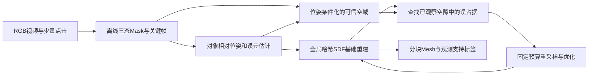

# RGB-only 刚体细结构 Mesh：论文、代码与 12GB 可行性审计

调研日期：2026-10-19（Asia/Shanghai）。研究者：袁一杰。本文在检索过程中持续写入；尚未核验的条目不作为结论。

> **第三轮续研（当前结论）：**用户优先静置手办/雕塑，唯一候选现收窄为《观测约束可表示性驱动的刚体细结构局部重建》，详见 [核心算法与摘要](./2026-10-19_core_algorithm_proposal.md)。本文保留完整相关工作矩阵及早期位姿方案作为研究历史。GSNSR、SSP全文已补齐；CASA-SDF新核到作者训练峰值9.97GB；本机仍未运行，创新性仍不能确认。

> 已完成两轮论文与静态代码调研，并形成单一候选及实验协议。新增近邻与反例见 [第二轮核查](./2026-10-19_followup_findings.md)，具体实施/评价见 [12GB验证方案](./2026-10-19_12gb_validation_plan.md)。仍未进行训练与完整流程峰值测量；创新性目前不能确认。原 [进度记录](./2026-10-19_PROGRESS_HANDOFF.md)保留为中途检查点。

## 进度与证据规则

- [x] 已读取 `RESEARCH_DIRECTION.md` 与用户给出的项目约束。
- [x] 已读取多篇本地 PDF 与官方论文；逐项证据深度和未取得全文的限制见正文。
- [x] 已建立 13 项指定工作的矩阵并静态审计关键代码路径；无本机运行证据。
- [x] 已完成候选 2/4/5 的首轮反创新性审查；最近先例仍有全文待核。
- [x] 已提出一个可证伪核心，完成首版12GB实验协议及停止条件。
- [x] 第三轮已补齐GSNSR、SSP全文并比较关键公式。
- [ ] 新核心的创新性确认及完整近邻排除。
- [ ] 基线端到端运行及阶段显存实测（不是本轮文献调研已完成项）。

证据标记：**[P]** 原论文/补充材料明确报告；**[C]** 官方代码/README/配置直接可见；**[I]** 基于上述事实的推断；**[H]** 待验证研究假设；**[M]** 本机运行测量。本次尚无重建运行测量，不能把静态审计写成 [M]。

显存规则：GPU 型号、总容量、作者声称的最低配置、单次峰值、完整流程峰值分别记录。`未报告/未核到` 不等于显存很低或一定 OOM。PyTorch allocated/reserved 无法覆盖全部 CUDA/C++ 分配，最终需结合设备/进程采样。

## 已确认的任务边界

单个不变形刚体，单目 RGB，一段或多段视频；允许交互 Mask；每帧相机—物体相对位姿统一至对象坐标系；输出独立 Mesh。手、桌面遮挡属于 UNKNOWN，不能简单当背景自由空间。真实活动的人手不在当前目标内，手形刚性模型的指缝属于目标。

离线允许重优化旧数据，因此“后来看到后可以改正”和“canonical space”本身不能预设为创新。RGB-only 的绝对尺度不可直接辨识，毫米级评价需要尺寸参照或 GT 对齐，并报告对齐方式。

## 研究日志

### 批次 0：先建立可交付档案

已创建本文。旧项目档案中的 GPU/代码状态只作为检索线索，后文重新查官方材料。不会先安装或运行全部重型基线，也不会给出未经实测的“12GB 保证可运行”承诺。

### 批次 1：已找到直接否定宽泛创新表述的证据

- [P] [ObjectCarver / 3DV 2025](https://objectcarver.github.io/) 已有用户点击、跨视角 Mask 传播、分对象 SDF、避免遮挡误雕刻的损失；因此“三态遮挡思想 + SAM + 对象 Mesh”不能直接宣称新。
- [P] [SparseFlex / ICCV 2025](https://openaccess.thecvf.com/content/ICCV2025/html/He_SparseFlex_High-Resolution_and_Arbitrary-Topology_3D_Shape_Modeling_ICCV_2025_paper.html) 明确提出稀疏等值面表示、视锥分区训练及 1024³ 级高分辨率。因此“稀疏、分块、只激活可见体素”已有强先例，需继续核验实际输入和资源。
- [P] [ExMesh / CVPR 2026](https://openaccess.thecvf.com/content/CVPR2026/html/Fan_ExMesh_EXplicit_Mesh_Reconstruction_with_Topology_Adaptation_CVPR_2026_paper.html) 直接研究显式 Mesh 的拓扑自适应；不能把“可改拓扑”或“局部细化”当空白。
- [C] [GPU-SDF 官方仓库](https://github.com/IRMVLab/GPU-SDF) 本次页面仅见 README 与预计算 Mesh 下载，不见训练实现。论文名称中的 GPU 指 geometric prior uncertainty，不意味着 GPU 内存优化。
- [P] 本地 Dyn-HOR PDF §4.1 报告 100 帧约 1 h 位姿初始化 + 8 h 重建、RTX 3090；DG-Mesh §4.2 报告 RTX 3090 Ti、50k 次迭代；DynaSurfGS 实验节报告 RTX 3090、20k 次迭代。以上均不是峰值显存测量。

下一步：审查位姿不确定性究竟影响射线几何还是只有损失权重，并区分真实自由空间证据、几何先验不确定性和新视角渲染不确定性。

### 批次 2：显存实数与多姿态融合的近邻

- [P] [MILo 论文 §6.1](https://arxiv.org/html/2506.24096v2#S6.SS1) 报告：实验在 RTX 4090 24GB 上进行；基础版 0.1–0.5M Gaussians、训练约 10GB；dense 2–4M Gaussians、最高约 17GB。**这是作者报告训练用量，未明确统一峰值测量 API/全流程口径；不是本机实测。** 基础版值得 12GB 试验，dense 默认不适合作为本机起点。
- [C] MILo 官方 README 有 `--data_device cpu`、`lowres`/`verylowres` 和采样率开关；README 的“Mesh <20/50MB”是输出文件大小，不是显存。默认/高分辨率三角剖分规模可达百万至千万点，峰值需单独量。
- [C] [Neuralangelo FAQ](https://github.com/NVlabs/neuralangelo#frequently-asked-questions-faq)：默认至少 24GB；12GB 建议 `dict_size=21, dim=4`，明确可能牺牲质量。提取支持 `BLOCK_RES`，故分块 Mesh 提取早已有实现；`--keep_lcc` 还可能删除细结构。
- [P] [PoseFusion / Computer-Aided Design 2026](https://www.sciencedirect.com/science/article/pii/S0010448526000710) 已做多次物体摆放、分别重建神经 SDF、粗到细配准与统一融合。其数据为不同摆放下的已标定多视图，不能等价于任意手持未知位姿，但直接否定“跨摆放 canonical 融合就是新贡献”。[官方项目/代码数据](https://raining00.github.io/PoseFusion-page/)。
- [P] ExMesh 的自适应分裂分数包含位置梯度与曲率。[I] 这证明误差/曲率驱动局部加密已有先例；然而边分裂和合法边折叠不自动等于能打通被错误封闭的孔洞，需区分三角网连接更新与物体拓扑纠错。
- [P] Dyn-HOR 使用生成 Mesh 作**位姿初始化先验**，再用真实观测优化 SDF。不能把整个方法简单说成“生成结果”，也不能把其未知区自动视为观测真值。

### 访问边界

部分 arXiv PDF 和 GitHub API 请求遇到 TLS/证书错误；已改用官方论文 HTML、CVF PDF、官方 README 和项目页。失败请求记录在 `evidence/fetch_manifest.jsonl`；不会把未下载的全文说成已读。代码仅做静态读取，不安装依赖、不运行训练。

## 相关工作矩阵

为避免把“静态世界坐标系”误写成“已解决物体自由运动”，canonical 分三种：**O** = 逐帧刚体变换到物体坐标；**W** = 已标定静态场景共享坐标，可用于静止对象；**D** = 非刚性动态 canonical + 形变。下表方法属性来自论文 [P]，代码/资源另表 [C]；“无专门机制”指本次核查的目标函数/流程中未见，并非证明所有扩展均不存在。

### A. 输入、几何与问题适配

| 工作、正式状态、原始来源 | 输入 / 位姿是否已知 | Mask | canonical | 表示 → Mesh | 细薄结构与遮挡机制 | 对本任务的主要缺口 |
|---|---|---|---|---|---|---|
| [Dyn-HOR, CVPR 2025](https://east-j.github.io/dynhor/) | 单目 RGB 动态手—物；估计并联合优化相对位姿；生成 Mesh 用于初始化 | 分割与预处理 | O | 神经 SDF → 等值面 Mesh | 语义位姿初始化、跨视角 pose-outlier voting；不是专门间隙保真目标 | 最接近自由交互；生成先验可能带来位姿偏差；未报告间隙/误桥指标 |
| [BundleSDF, CVPR 2023](https://bundlesdf.github.io/) | **RGB-D**；在线估计/精化位姿 | 首帧 Mask + 跟踪；自定义代码可给逐帧 masks | O | 哈希神经物体场/SDF → 纹理 Mesh | 特征匹配、pose graph、记忆帧池、深度/空域约束，处理遮挡 | 输入多了实测深度；不能直接用它证明 RGB-only 已解决 |
| [In-Hand, CVPR 2023](https://rgbinhandscanning.github.io/) | RGB 序列；未知位姿，分段优化再对齐/全局优化 | 手/物体分割 | O | occupancy/颜色隐式场 → Mesh | 遮挡像素处理、跨片段融合；文中承认薄物体与跟踪失败 | 很像扫描目标；完整可复现代码未找到；不能承诺高精细指缝 |
| [HOLD, CVPR 2024](https://openaccess.thecvf.com/content/CVPR2024/html/Fan_HOLD_Category-agnostic_3D_Reconstruction_of_Interacting_Hands_and_Objects_from_CVPR_2024_paper.html) | RGB；对象 SfM + 手估计初始化，再精化 | 手/物体分割 | O（物体）+ D（手） | 手/物体独立 SDF + 背景场 → Mesh | 组合渲染、手物接触、MANO 先验；未知处可能有伪影 | 为了只重建物体而承担手模型成本；低纹理/薄结构 SfM 可失败 |
| [DG-Mesh, ICLR 2025](https://www.liuisabella.com/DG-Mesh/) | 带相机参数的动态单目序列 | 真实视频要求前景分割 | D | canonical Gaussians + 双向形变 + DPSR/MC → 逐时刻 Mesh | Gaussian-Mesh anchoring、cycle consistency；展示鸟翼等薄结构 | 重点是非刚性时序表面；不解决手/桌面三态语义和自由刚体位姿 |
| [DynaSurfGS, arXiv 2024](https://open3dvlab.github.io/DynaSurfGS/) | 标定动态多视图/单目数据设置，不能把相机已知偷换为目标相对位姿已知 | 随数据预处理；无手物专门三态前端 | D | 平面 Gaussians + 4D 特征/形变 → 渲染深度 TSDF Mesh | 法线正则与局部 ARAP；表面连贯性 | 非刚性复杂度多余；正式录用本次未确认；代码仍占位 |
| [ObjectCarver, 3DV 2025](https://objectcarver.github.io/) | **已知位姿**多视 RGB；静态多对象 | 一视图点击 → SAM → 跨视图传播 | W（每对象独立 SDF） | 场景 SDF 初始化每对象 SDF → MC Mesh | amodal bbox、present-but-occluded mask、compactness/overlap；抑制误雕刻/接触污染 | 不估自由物体位姿；依赖先前几何；不是显式 pose uncertainty / gap 指标 |
| [DebSDF, TPAMI 2024](https://arxiv.org/abs/2308.15536) | 已知相机位姿的室内 RGB + **预测**深度/法线先验 | 不以交互对象 Mask 为核心 | W | SDF + 先验不确定性场 → Mesh | 不确定性过滤、重要性射线采样、自适应平滑、SDF→密度偏差修正；明确针对薄结构 | 不确定性是先验误差，非 SE(3) 位姿传播；场景分离/手遮挡不在核心 |
| [GPU-SDF, arXiv 2026](https://arxiv.org/abs/2602.23926) | 已位姿室内 RGB + 预测几何先验 | 不以对象 Mask 为核心 | W | SDF/ND-SDF 后端 → Mesh | 先验 uncertainty、edge distance field、高不确定区域多视一致性；明确补薄结构 | 已覆盖“边缘 + 不确定性 + 局部采样”的宽泛组合；无完整训练代码可核 |
| [NeAT, CVPR 2023](https://openaccess.thecvf.com/content/CVPR2023/html/Meng_NeAT_Learning_Neural_Implicit_Surfaces_With_Arbitrary_Topologies_From_Multi-View_CVPR_2023_paper.html) | 已位姿多视 RGB（另有单图扩展，不能混用） | 多视实验含 Mask；代码有不同配置 | W | SDF + validity → 可开放 Mesh | 支持单层开放表面；validity 过滤不能等同“是否被观察” | 原文仍有雨伞细杆失败、遮挡导致领口粘连；任意拓扑表达不保证正确拓扑 |
| [NeuS2, ICCV 2023](https://vcai.mpi-inf.mpg.de/projects/NeuS2/) | 已位姿多视 RGB；动态扩展是另一个设置 | 主线可用 Mask；neuspp 分支支持无 Mask/无界 | W（本课题仅用静态后端） | CUDA/hash SDF → MC Mesh | 多分辨率渐进训练、二阶导实现；非间隙/遮挡专门机制 | 速度快不代表低峰值；默认图像驻留和密集提取需审计 |
| [Neuralangelo, CVPR 2023](https://research.nvidia.com/labs/dir/neuralangelo/) | RGB + SfM 已估相机位姿 | 可无对象 Mask；本任务需额外对象隔离 | W | hash SDF、数值梯度、逐级细化 → 分块 Mesh | 高频几何恢复；不专门处理手持污染 | 默认显存大；降配可能损细节；不会自动估计自由运动物体位姿 |
| [MILo, SIGGRAPH Asia/TOG 2025](https://anttwo.github.io/milo/) | RGB + COLMAP/标定位姿 | 不强制对象 Mask，原目标包括全场景 | W | Gaussians + Delaunay pivots/SDF + 可微 MT → Mesh | mesh-in-loop、anti-erosion、内部约束；支持细结构并动态更新连接 | 不处理手/桌面隔离与姿态后验；防侵蚀和保留真实空隙不是同一目标 |

**水密与薄结构不是对立项。** 有厚度的手形雕塑、梳子、穿孔实体通常可用闭合 SDF 表示；NeAT 的单层开放面能力主要解决零厚度/布片式表面。不能因为有孔洞就认定必须用开放面方法。反过来，未观察的杯底强制封口会引入推断几何。

### B. 显存与代码矩阵（本次全部未进行本机训练）

`NR` = 在本次实际读取的材料中没有核到可复用的完整峰值数字；不代表作者所有材料都绝无记录。

| 工作 | 作者硬件 / 用量证据 | 峰值与 12GB 判断 | 2026-10-19 官方代码状态 |
|---|---|---|---|
| Dyn-HOR | [P] 3090；100 帧约 1h 初始化 + 8h 重建 | NR；不能按 3090 24GB 推算实际用量 | [C] [main/dev](https://github.com/EAST-J/Dynhor)：main 提示重建在 dev；dev 为 instant-nsr-pl 且标 WIP，并非完整论文配置保证复现 |
| BundleSDF | 本次主文/README 未核到完整内存口径 | NR；仅 RGB-D 对照，MVP 不依赖 | [C] [官方实现](https://github.com/NVlabs/BundleSDF)，自定义 RGB-D、global_refine、纹理 Mesh 输出；XMem 需额外集成 |
| In-Hand | 主文未核到 GPU/峰值 | NR；无法据此判定 12GB | [C] [项目页](https://rgbinhandscanning.github.io/)有论文/结果下载，未见完整训练代码；HOLD 补充材料当时也注明未发布 |
| HOLD | [P] 补充材料：初始 fitting 用 2080 Ti；pose refinement 用 A100、分批 51 帧 | **不能把初始化卡型当整条管线可运行证明**；峰值 NR | [C] [官方 beta](https://github.com/zc-alexfan/hold)有训练/自定义流程；`docs/setup.md` 提醒 OOM 降 `--num_sample`；`optimize_ckpt.py --batch_size` 单独控制位姿阶段 |
| DG-Mesh | [P] 3090 Ti、50k iterations | NR；DPSR/网格/动态网络会额外占资源 [I] | [C] [代码与数据](https://github.com/Isabella98Liu/DG-Mesh)已开放；本次未本机编译 |
| DynaSurfGS | [P] 3090、20k iterations | NR | [C] [仓库](https://github.com/Open3DVLab/DynaSurfGS)只有 assets/README，并注明 code coming soon；不列为可直接运行基线 |
| ObjectCarver | [P] 3090；场景/每对象 batch 512/64；多 SDF | NR；单对象裁剪可能降资源 [I]，尚无 12GB 实测 | [C] [代码](https://github.com/gemmechu/ObjectCarver)：全场景→传播 Mask→对象分离→网格，脚本齐全不等于本机已复现 |
| DebSDF | 本次读到方法/训练流程；GPU 峰值口径未核全 | NR；先验预处理与重建需分开计量 | [C] [代码/权重](https://github.com/DavidXu-JJ/DebSDF)已发布，基于 MonoSDF/Omnidata |
| GPU-SDF | [P] 4090、128k iterations、约 24 GPU h | NR；24 GPU h 是计算时间，不是 24GB 峰值 | [C] [仓库](https://github.com/IRMVLab/GPU-SDF)仅 README/结果 Mesh；正式发表本次未确认 |
| NeAT | 主文与 README 未核到完整峰值 | NR；多 MLP、射线 batch 可调不等于已验证 | [C] [完整研究代码](https://github.com/xmeng525/NeAT)，配置和导出存在 |
| NeuS2 | [C] CUDA/hash 实现、参数可调 | NR；是**待量测的轻量后端候选**，非“官方已证明 12GB” | [C] [代码](https://github.com/19reborn/NeuS2)完整；本次读取了 hash 配置、loader、运行脚本与 MC CUDA |
| Neuralangelo | [C] FAQ：默认至少 24GB；12GB `dict_size=21, dim=4`；8GB 也有建议 | 官方建议不是逐阶段实测；质量可能下降；训练、验证、导出需分别压峰值 | [C] [代码](https://github.com/NVlabs/neuralangelo)完整，本次核到分块提取入口 |
| MILo | [P] §6.1：4090；base 约 10GB、dense 最高约 17GB | **最有价值的训练用量证据之一**；未给本机/完整峰值口径；base 12GB 值得试，dense 不作默认 | [C] [代码](https://github.com/Anttwo/MILo)完整；CPU 图像选项、Mesh 分辨率开关；default YAML 有 5.4M Delaunay 点上限，仍需查实际分支/配置 |

### C. 补充先例：会改变选题判断的 2023–2026 工作

| 工作 / 状态 / 来源 | 输入与贡献边界 | 对候选思想的影响 | 代码和资源证据 |
|---|---|---|---|
| [PoRF, ICLR 2024](https://arxiv.org/abs/2310.07449) | RGB + noisy initial pose；pose residual MLP + epipolar loss，联合表面优化 | 改善位姿再改善几何已做；点估计优化不等同后验传播 | [官方代码](https://github.com/ActiveVisionLab/porf)；[P] A40、50k/约2.5h；峰值未核到 |
| [NeuRodin, NeurIPS 2024](https://github.com/Open3DVLab/NeuRodin) | posed RGB，SDF 拓扑探索、密度偏差修正、两阶段细化 | 不能把“让 SDF 改拓扑/恢复细节”笼统作为创新 | 官方研究实现；12GB 未验证 |
| [SparseFlex, ICCV 2025](https://arxiv.org/html/2503.21732v1) | 稀疏 FlexiCubes、视锥分区；核心实验含 **Mesh 采样点云/法线 → VAE 重建**与生成；训练监督含深度/法线/Mask 渲染 | 稀疏表示和局部激活已有；不是现成真实 RGB 扫描器 | [TripoSF](https://github.com/VAST-AI-Research/TripoSF)发布 VAE 推理/表示；README ≥12GB 指该路径；[P] VAE 训练 64×A100，不能误写为 12GB RGB 训练证据 |
| [MILo, TOG 2025](https://anttwo.github.io/milo/) | 每迭代从 GS 参数可微提取 Mesh，反馈几何，anti-erosion | “网格监督 + 细节保持 + 高效采样”已做；强质量/资源对照 | base 10GB 作者报告，详见上表 |
| [Sparfels, ICCV 2025](https://github.com/Shubhendu-Jena/Sparfels) | 稀疏未知位姿 RGB、前端对应/初始化与 bundle-adjusted surfels | 应作为自由位姿前端/联合优化近邻，不等同间隙安全雕刻 | 已有官方代码；本次未核到本机峰值 |
| [PoseFusion, CAD 2026](https://raining00.github.io/PoseFusion-page/) | 每次摆放内已标定 RGB；分别学习 SDF，再跨摆放配准融合 | 多会话/翻面后的 canonical 融合不能单独宣称新 | 官方 code/data release 链接已核到；本次未审完训练实现、未核峰值 |
| [ExMesh, CVPR 2026](https://arxiv.org/html/2606.07288v1) | posed RGB + 初始粗 Mesh；当前代码含 DA3 深度先验与 PGSR 初始化；梯度/曲率驱动 split/merge、UV 同步 | 自适应网格加密已有；不应把网格连边调整夸大为任意洞口恢复 | [代码](https://github.com/Fan-Treasure/ExMesh)已发布；完整预处理+训练峰值未核到 |
| [UGS-Loc, CVPR 2026](https://openaccess.thecvf.com/content/CVPR2026/html/Kong_Rethinking_Pose_Refinement_in_3D_Gaussian_Splatting_under_Pose_Prior_CVPR_2026_paper.html) | 既有 3DGS 场景上的定位；Monte Carlo 位姿先验 + 几何不确定性/Fisher PnP | 位姿采样/不确定性本身已有；不是对象 Mesh 融合任务 | 官方 CVF 摘要/论文入口；本次未审代码，不虚报显存 |
| [GSNSR, EGSR 2026 Symposium Track](https://diglib.eg.org/items/6869b7a4-d955-48f9-974a-fe84a18b4f43) | 第三轮已读全文§4.1–4.2：3DGS伪深度之前的区间，按置信度惩罚体渲染权重 | **“置信度加权自由空间损失”已有非常直接近邻**；不是局部表示可行性判据 | PDF已保存；4090、300k步约8h，峰值NR；官方实现未找到 |
| [SSP, WACV2024](https://github.com/Runsong123/SSP) | 无定向点云；符号已知/未知区，按体素历史损失分配采样 | “空域冲突大就多采点”不能笼统作为创新 | 正文与官方代码入口已保存；2080Ti，峰值NR |
| [CASA-SDF, Neurocomputing2026](https://arxiv.org/html/2607.13492v1) | posed RGB+预测几何先验；局部曲率调SDF密度锐度、先验退火 | 自适应薄结构恢复已有；与增加节点自由度不同 | 作者训练峰值9.97GB，4090；非全流程/3060实测，官方代码未找到 |
| [NeRF2Mesh, ICCV2023](https://github.com/ashawkey/nerf2mesh) | posed RGB；粗Mesh→按反投影渲染误差细分/简化、几何纹理优化 | 显式局部加密与薄结构恢复已有；不是观测约束可表示性检验 | 全文/官方README已读；V100 16GB为硬件；Table3是导出资产渲染显存，非训练峰值 |
| [ICON, CVPR 2024](https://weiyaowang.github.io/icon/) | RGB 视频、平滑运动先验；高置信位姿训练场、高置信结构训练位姿；含 Mesh 示例 | “位姿—几何互相置信加权”已做；点/帧权重不自动等于位姿分布传播 | 本次读官方摘要/项目页，页面代码待发布；峰值未核 |
| [UA-Pose, CVPR 2025](https://minfenli.github.io/UA-Pose/) | **RGB-D**测试序列；部分 RGB-D 参考或单图生成初始化；对象中心 SDF → Mesh；seen/unseen、seen IoU、帧池与新观测更新 | 直接覆盖“已见/未见 + 位姿拒绝 + 后续纠错”；方法中的不确定性主要是可见性，不是每点相对位姿分布 | 本轮已读正式论文方法节；[仓库](https://github.com/minfenli/UA-Pose)只有 images/README、实现待发布；峰值未核 |
| [ManifoldNeuS, CVPR 2026](https://openaccess.thecvf.com/content/CVPR2026/html/Liu_ManifoldNeuS_Manifold-aware_View_Optimizability_for_Pose-Free_Neural_Surface_Reconstruction_CVPR_2026_paper.html) | 未知外参、已知内参 RGB；对应图谱嵌入、每视图拟合/覆盖价值调度、门控编码与损失加权，NeuS → Mesh | 困难/覆盖视图的优化调度已做；其视图图拓扑覆盖不能等同物体细缝拓扑 | 本轮补读方法/实验正文；RTX5090、每轮50k位姿+最终200k表面，峰值未核；代码未确认 |
| [2DGS, SIGGRAPH 2024](https://surfsplatting.github.io/) / [GOF, SIGGRAPH Asia 2024](https://niujinshuchong.github.io/gaussian-opacity-fields/) | posed RGB → surfels/opacity field → Mesh | GS 不是只能渲染；但深度融合/网格提取可能丢薄结构，需量最终 Mesh | 分别有[2DGS代码](https://github.com/hbb1/2d-gaussian-splatting)、[GOF代码](https://github.com/autonomousvision/gaussian-opacity-fields)；本次不提供未核资源数字 |

检索还命中 STAC、G²SR（2026）、ND-SDF/H2O-SDF 等线索。它们未全部达到全文/代码审计深度，列入创新复核待办，**不能用“本次没看到同款”证明没人做过**。G²SR 摘要的少视图低显存数字也不能外推为完整手机视频→独立高精细 Mesh 的成本。

时间窗口外仍须追溯 [PSDF Fusion](https://arxiv.org/abs/1807.11034)、[概率 visual hull](https://www.cs.utexas.edu/~grauman/research/projects/vhreg/vhreg.html)、体素哈希/TSDF streaming：概率融合、轮廓不确定性与有限显存重建不是 2023 年后才出现的新概念。这里引用其原则性先例，不假定已逐式排除了全部经典算法。

更直接的早期反例是 [Tabb, CVPR 2013](https://openaccess.thecvf.com/content_cvpr_2013/papers/Tabb_Shape_from_Silhouette_2013_CVPR_paper.pdf)：概率轮廓/占据优化用于分割和标定误差下的薄物体重建。因此“对轮廓不确定性做鲁棒处理来保护细结构”也不是新问题；[作者页](https://amytabb.com/publications/)包含式(5)勘误。正式对照需按修正定义。

## 候选创新审查

### 2. 位姿不确定性感知的 canonical-space 融合

**宽泛表述不成立为创新。** In-Hand、HOLD、Dyn-HOR 已做对象中心的位姿—形状估计；BundleSDF 已做 pose graph 与共享神经对象场；PoRF 专门修正位姿噪声；PoseFusion 已处理多次摆放间 SDF 对齐融合；概率 TSDF/visual hull 和 2026 UGS-Loc 又覆盖概率推理与位姿采样。

要区分三件事：①以残差给帧降权；②把位姿当变量联合优化；③把 SE(3) 的不确定集合/分布传播到每个三维点的投影和自由空间判定。前两者不自动等于第三者；但是第三者的数学工具（协方差传播、鲁棒优化、chance constraint）也不是新发明。

本次没有核到一篇已完整实现“RGB 手/桌面遮挡、位姿误差传播、细缝自由空间保真、受控显存”全部条件的论文，**但目前不能确认该组合具备足够创新性**。条件的并列不是贡献，必须有独立机制和胜过强简单基线的结果。

### 4. 拓扑风险驱动采样/局部细化

已有：DebSDF 的不确定性重要采样与自适应平滑；GPU-SDF 的边缘场/高不确定区域一致性；NeuRodin 的 SDF 拓扑探索；NeAT 的开放表面表示；MILo 的可微 Mesh/防侵蚀；ExMesh 的梯度和曲率驱动分裂/合并。只把采样权重换一个名字不够。

**可继续试验的窄差别**：风险直接来自“真实可见的空隙被当前 Mesh 占据”与“在可信位姿误差范围内这个空隙是否仍可判定”，而不是 RGB 梯度、法线变化或网络不确定性本身。需要保护的是空域通道及其两侧实体，不是只把边缘渲染得锐利。

切勿用全局连通分量数或 Euler characteristic 独自表示“指缝正确”：五根手指在掌根本来就连通，缝被填后全局 component 数不变，某些 Betti 数也可能不变。必须检查指定局部 ROI 内的空域通行性、间隙宽度与桥接占据量；不得允许检测路径绕到手掌外面“假通过”。这也意味着题目宜叫**间隙/细结构保真**，除非做出了严格拓扑定义与证据，不急着自称拓扑保持算法。

### 5. 固定 12GB 的稀疏、分块、流式 Mesh

已有：哈希编码、稀疏体素、分块提取、CPU offload；Neuralangelo 官方已经提供分块 MC，SparseFlex 有视锥分区，经典重建有体素交换。**“能跑 12GB”更适合本题的强制实验约束，而非单独创新点。**

若要单做系统论文，还需新的资源调度/数据结构与质量—内存—时间曲线，且需在相同预算比较强基线。对当前硕士收敛而言，另开这一条主线会把工作量扩成系统工程；本建议只复用必要的内存控制。

### 最接近工作的对抗式核查

| 审稿人的否定意见 | 必须给出的证据，否则停止 novelty 声称 |
|---|---|
| 这就是 ObjectCarver 换了个应用 | 同样三态 Mask/对象隔离规则下，在同一后端加入/去掉位姿传播与空域风险；证明收益不只是遮挡排除 |
| 这就是 DebSDF/GPU-SDF 多采边缘 | 等采样数/等时间，与不确定性、边缘、曲率、随机采样比较；在细缝 ROI 上有稳定优势 |
| 这就是 GSNSR 的 confidence free-space loss | 第三轮已读§4.2式(7)–(9)，是伪深度前空域的置信加权；因此单个标量置信权重不是差异。新候选转向局部离散表示的约束兼容性，但新颖性仍未确认 |
| 对 Mask 做膨胀/腐蚀就能解决 | 比较固定像素宽、按噪声自适应宽、逐点 Jacobian 宽；若简单形态学同样好，就承认模块不够新 |
| 只是更多点击、更准位姿、更长时间 | 固定点击预算、输入、前端、位姿和训练预算；额外手工 gap 标注须单列公平对照 |
| 只是把网格多分了一些三角形 | 基础场固定，仅提高 MC 分辨率的对照；相同最终分辨率/内存下再比较重建改进 |
| 减少桥接是因为把细杆也削没了 | 同时约束细杆召回、厚度偏差、局部 F-score 和可见表面完整度；不能只汇报 gap survival |
| 没看到的地方被删除，所以指标变好 | 报告 coverage/abstention 与全输出指标；未知区标签与实际缺面分开统计 |

## 最终单一建议

### 推荐题目（工作名，不是已确立的论文贡献）

**《位姿不确定性下基于可观测自由空间的刚体细结构重建》**

只研究一个核心：**面对同一条实际拍清楚的细缝，决定哪些空域证据可信、哪些还应保持未知，并把有限采样预算用于防止这条缝被重建结果填死，同时保护相邻细杆。**

12GB 是必须满足的资源边界；分割、初始位姿、哈希 SDF、网格导出均尽量复用。多会话对齐只作后期压力测试。目标不是再造一个通用扫描器。

选择理由：[I] 它最直接对应用户“不是鸭掌”的实际目标，有明确可控失败变量，不需要训练大生成模型；能利用研究者 CUDA/C++ 能力优化点查询和有限预算采样；即使自由位姿前端尚不成熟，也能先用 Oracle 与受控噪声检验核心，不再让 OOM 或前端失败掩盖论文问题。

**创新性结论：目前不能确认。** 下文为早期位姿方案的历史草案；第三轮已补读GSNSR，当前唯一建议以页首链接的局部可表示性方案为准。已有工作大量覆盖组成部分，不能称“已找到无人做过的方向”。

### 可执行方法草案 [H]

1. **对象坐标与观测账本。** 固定第一段的对象坐标规范，存下原始 RGB、内参、每帧 `T_camera←object`、Mask 来源/修订版本。OBJECT 仅表示看到目标表面；FREE 只标明确露出的背景/缝隙；手、桌面、模糊边界为 UNKNOWN。UNKNOWN 不提供正几何，也不提供穿透遮挡物的空域证据。Mask 可以人工校验，交互数要记账。
2. **先有可用位姿，再估残余不确定性。** 从对象内特征做 SfM/跟踪，必要时局部片段重定位；不能让静态背景的相机轨迹冒充运动物体相对轨迹。用 BA 重投影残差的 bootstrap/分段一致性估计局部位姿扰动集合，并固定 gauge；先在合成噪声上校准覆盖率。对称物体有多个相互分离的位姿解释时保留多假设或拒绝，不用小高斯方差假装解决。
3. **从“权重低一点”改为“空域的位置是否仍成立”。** 对对象空间点 x，把合理位姿集合中的各投影都检查一遍：如果有假设把它投到 OBJECT 或 UNKNOWN，就不对它做强制雕刻。只有在可信假设内都投到安全 FREE 内部，并且在图像/有效视线范围内，才形成保守空域候选。粗筛可用投影 Jacobian，少数风险点再采样位姿假设；不复制 SDF 网络。
4. **寻找被模型填掉的可见缝。** 把这些空域候选与当前 SDF/低分辨率 Mesh 交叉检查。只给“有可靠空域支持、当前预测被占据、局部存在两侧表面观测”的位置高采样优先级。光照纹理边缘不会自动触发，完全没看到的空隙也不能凭先验触发。分配预算时保留普通表面/全局探索样本，不能把所有算力都给不确定区域。
5. **优化一个全局哈希 SDF。** 首选在 NeuS2 静态后端上添加小批量空域查询与采样规则，使用原 RGB/表面损失和保守空域项；先不发明局部神经网络拼接。仅提高已确定高风险区域的查询/导出分辨率，并做有无自适应查询的消融。若底层场已没有间隙，提高 MC 分辨率不会凭空补回来。
6. **后续真观测纠错。** 保留旧观测并离线重新优化；根据修订后的 Mask/位姿重建证据缓存。共享哈希参数受到多帧耦合，不能宣称删掉一帧权重就实现精确回滚；必要时从 checkpoint 重训受影响阶段。此更新能力是任务要求，默认不列新贡献。
7. **导出可审查结果。** 分块查询同一个 SDF，统一坐标和阈值、重叠 halo、共享边顶点去重，避免块缝；输出 Mesh + 每面观测支持数/角度覆盖/置信度。交付观测支持表面，未知面单独标记或剔除；未经覆盖证据不得全部标成“真实扫描”。纹理烘焙在几何定型后独立进行。

#### 研究核心的最小数学定义

令 `d_i(u)` 是图像中 FREE 区域到其边界的有符号距离（内部为正，OBJECT/UNKNOWN/图像外为非正）。令 `U_i` 是校准后的相对位姿集合，`π_i(Tx)` 是投影。定义：

```text
m_i(x) = inf_{T ∈ U_i} d_i(π_i(Tx)) - ε_mask
```

满足投影可见性/深度有效性且 `m_i(x)>0` 才允许该帧对 x 形成强 FREE 证据。深度方向也必须限制在目标 ROI 内；真正的遮挡物后方仍为 UNKNOWN。多帧只在各自可靠的空域集合上累积，不把相互冲突的射线盲目平均成厚表面。

一阶近似可用 `Σ_u(x) = J_i(x) Σ_pose,i J_i(x)^T + Σ_mask,i`，根据投影边界法向的方差形成位置相关安全带。其价值在于不同位置/深度的位姿误差不同；**这也是必须和“按噪声自适应腐蚀 Mask”正面对比的原因**。

注意：有限 Monte Carlo、sigma points 或一阶协方差传播都不能证明上式的连续集合下界。实现阶段只称“保守近似/风险控制”，并实测误刻率；除非证明了边界，否则不叫安全证书/拓扑保证。BA 的信息矩阵还可能因 gauge、错误匹配和视角相关性失真，必须校准而非直接把逆 Hessian 当真后验。

局部样本优先级的起始假设为：

```text
priority(cell) ∝ reliable_free_support(cell)
                 × predicted_occupancy_conflict(cell)
                 × local_gap_relevance(cell)
                 / estimated_query_cost(cell)
```

其中 `local_gap_relevance` 需由局部受限空域通道/两侧可见表面定义，**不能只把曲率重命名为“拓扑风险”**。首版可以手动给少量 gap ROI 以验证机制，再测试自动提议；手动版本不是自动系统结果，且所有对照获得同样 ROI/点击信息。

### 实际可行管线与失败边界



这条管线有三个无法绕过的边界：①物体完全无纹理/对称且对应不足，可能无可用相对位姿；②缝始终被遮挡或只有亚像素宽，不能忠实恢复；③置信区间比缝还宽时，保守判定应暂缓，而非为了图好看强行打洞。后一情况应该提示新增近景/侧向视角，并在实验中量化 abstention 与后续恢复率。

用近似 `w_px ≈ f_px·g/z` 检查采集分辨率。例如 `f_px=1000, z=0.5 m, g=1 mm`，缝只有约 2 px；后处理将图缩小一半后约 1 px。此时“省显存靠缩图”直接抹掉目标证据。核心优先采用少帧、patch/ray mini-batch、CPU 图像缓存，而不是先把所有图片缩到 320×240。上述是针孔近似的例算，真实有效宽度还受视角、模糊和镜头 MTF 影响。

### 对上述方法的进一步自我否定

[I] 当位姿误差在局部等效为二维半径r的平移圆盘时，“所有投影都在FREE”与FREE区域腐蚀r等价；直缝保留下来的可信宽度是 `max(0,w-2r)`。因此本报告的保守投影公式不是现成novelty，也不能保证把任意缝恢复出来。必须正面击败自适应腐蚀这一强简单基线。

[H] 本题可尝试的机制是**在同样可靠空域判定下识别当前错误占据，并把有限查询用于这些冲突，同时约束相邻实体不被误删**。位姿传播负责区分证据是否适用，局部冲突负责决定计算花在哪里；二者分别消融。既不能用“风险”重命名曲率，也不能仅更改空域损失系数。

“投影得到支持”不等于几何是真值。Mesh观测支持标签还须经过遮挡/可见性检查，且只能表达观测依据；错误位姿、错误Mask或错误当前几何仍可能使标签错误，需要独立保留视角和GT评价。

## 12GB 可行性：已经确认什么、尚未确认什么

### 代码可证的OOM风险

[C] 本次下载的 [NeuS2 marching_cubes.cu](https://github.com/19reborn/NeuS2/blob/main/src/marching_cubes.cu) 中，`marching_cubes_gpu` 分配 `res_x×res_y×res_z×3×sizeof(int)` 顶点索引工作区，随后还分配输出顶点/索引。1024³仅该工作区就是**12 GiB**，加一份FP32标量网格约4 GiB，尚不含模型与Mesh。因此不能在12GB设备上沿用这个整块路径。512³这两部分约2 GiB，但不等于总峰值为2 GiB。

[C] [Neuralangelo提取入口](https://github.com/NVlabs/neuralangelo/blob/main/projects/neuralangelo/scripts/extract_mesh.py) 已提供 `--block_res`。本课题可借鉴分块查询和提取，但需实际移植/实现并验接缝，不能只把NeuS2查询batch调小就认为整块工作区消失。

[C] NeuS2 loader 会分配GPU图像存储；源数据不在GPU的标志不等价于全程CPU缓存。[C] Dyn-HOR本地已存在的dev快照也默认将图像/Mask/法线放GPU，并允许射线batch动态增大。代码路径与快照版本详见续接记录；未fetch，不宣称它等于远端最新。

### 可形成闭环的具体策略 [H/I]

先30–60个关键帧、单个哈希SDF、受限射线/点查询；分割/位姿/训练/提取/纹理串行。尽量保留原图中细缝像素，以CPU缓存/patch查询减少驻留数据；提取用64³或128³ cells的有界块加halo，统一场与坐标，CPU合并并去重，不创建1024³全局三维不确定性数组。

这需要工程验证，**目前没有可诚实给出的完整流程实测峰值**。本轮只读设备查询确认RTX3060总量12288MiB；查询时约10418MiB空闲，后台占用会变化。这不是任一方法的运行成本。

详细预算、必留日志、内存下界和失败处理已写入 [12GB验证方案](./2026-10-19_12gb_validation_plan.md)。所有PyTorch阶段记录allocated/reserved，同时用设备/进程采样覆盖CUDA/C++分配；分阶段串行峰值不可相加冒充并发，也不可漏报导出。

## 如何证明课题有效，而不是把模型削薄

1. **四格Oracle**定位误差来源：GT pose+GT mask；GT pose+SAM mask；noisy pose+GT mask；estimated pose+SAM mask。第一格先失败就查后端，不先归咎位姿。
2. **最小数据闭环**：梳状/穿孔/细杆/刚性手形合成物体，控制真实缝宽、投影像素宽、遮挡和时间相关位姿漂移；然后至少若干真实带纹理刚体。真正自由位姿结果必须单列，Oracle成功不是最终系统成功。
3. **同预算对照**：原SDF、确定性FREE、标量置信度、固定/自适应Mask安全带、边缘/曲率/随机采样；所有方法共享三态标签和交互预算。MILo base作高质量Mesh参照，ObjectCarver作已知位姿遮挡参照，Dyn-HOR作后期交互参照；不强迫本机运行全部重型方法。
4. **联合指标**：gap survival、局部空域通行/宽度、false bridge占据、细杆召回/厚度/断裂、confirmed free-space violation，以及Chamfer/F-score、法线、完整度、污染率、coverage/abstention、时间与显存。开放Mesh不盲目填洞后评体积；指标必须在独立/GT证据上算。
5. **新增观测纠错**：更新前、补视角重优化后、全部数据从头训练；新区域改善与旧区域退化都记录，不能只挑有利视角。

六周预实验的阶段产物、建议样本量和停止门槛见验证方案。门槛是预注册建议，不是已有结果，也不是学校毕业保证。服务器只用于重基线/规模扩展；本地闭环不能依赖尚未授权的A6000。

## 最终判断与剩余证据缺口

**当前只推荐《观测约束可表示性驱动的刚体细结构局部重建》作为待验证课题。** 见[第三轮具体算法](./2026-10-19_core_algorithm_proposal.md)；前述位姿方案保留为历史推导与后续鲁棒性消融。整条扫描管线或12GB降配不直接当贡献。

在已核材料里，尚未确认完整同构的新判据；GSNSR正文现已取得，但经典自适应重建、概率轮廓及近期相关工作不能宣称穷尽。因此，**目前不能确认创新性，也不能承诺最终Mesh的精度或所有12GB阶段可运行。** 如果同容量均匀细化/同预算误差采样解释全部收益，应明确否定当前核心。

本轮完成的是：13项指定工作矩阵、补充先例、关键代码显存风险、单一方法假设和可执行验证协议。尚未完成的是：实际重建、阶段峰值、真实细结构质量、以及发表前的全部近邻逐式排除。详细增量证据见 [第二轮核查](./2026-10-19_followup_findings.md)；来源获取结果见 `evidence/fetch_manifest.jsonl`，成功获取不等于所有内容都已细读。
