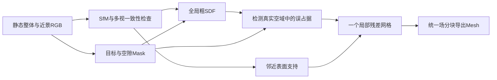

# 静置手办/雕塑：间隙约束驱动的局部残差 SDF 重建

日期：2026-10-19。基于用户最新收敛：优先静置手办/雕塑，在可控、充分覆盖的RGB拍摄下得到细节良好且指缝不误桥接的Mesh；大型兵马俑是尺度扩展。本文为算法设计假设，非成功复现或创新性证明。

> **后续具体化：**当前唯一核心、摘要与新增先例见 [第三轮算法方案](./2026-10-19_core_algorithm_proposal.md)。局部表示现明确为节点场替换+过渡带，以支持有限约束的可表示性检验；不能把下文任意非线性 `f0+w*r` 直接当作三线性场推导。本文保留为前版设计，不是另一项并列课题。

## 先给结论

**在这些受控条件下，12GB上得到保留可见指缝的静态Mesh，是值得实际推进、工程上有合理实现路径的目标。** 当前不需要把自由手持、任意重抓取及位姿后验估计同时作为主线。最值得投入的核心改为：

> 让真实可见的狭窄空域约束驱动局部几何自由度增加，并联合保住空域两侧实体；只把显存花到需要修复的局部。

工作名：**间隙约束驱动的局部残差SDF重建**。使用一个全局粗场确定整体形状，用一个或少数局部细网格学习残差修复手指等区域。不是把完整物体全部提升到最高分辨率。

“保住空隙”“局部细化”“残差场”“分块”分别都不是天然新贡献。潜在论文价值必须由冲突驱动的细化规则在同预算下的收益证明；**目前不能确认创新性。**

## 写入检查点

- 已确认：最新任务更适合静态摄影测量与局部几何细化；旧手持方案不再作为当前首要基线。
- 已核查：[COLMAP官方文档](https://colmap.github.io/faq.html)提供MVS与多种网格路径；已有可见性空域过滤/分块思路，不能把这些基础环节自称新算法。
- 已发现的新近邻：CrossSDF（CVPR2025，输入是二维截面，不是RGB视图）；CASA-SDF（2026，曲率相关空间自适应SDF密度），说明“自适应薄结构”仍需精确区分。本轮仅核官方摘要/出版页，不声称全文排除。
- 以下已具体化空域/实体联合约束、局部残差表示、内存算术、尺度与最小消融。

## 1. 当前任务简化的实际收益

首版拍摄时物体与环境均静止，只移动相机。此时SfM可以利用静止背景的特征估计相机位姿，几何阶段再排除背景；不必强行只靠手指上的少量纹理估位姿。若改成转台、移动物体、翻面后拍摄，背景与物体不再共享刚体变换，需要对象配准/分段处理，不能复用这个前提。

整体图、过渡距离图和手部近景需要相互重叠，保持统一尺度和坐标。孤立的一组手部微距不能自动接回整体。MVS得到的深度/法线是RGB多视图内部推断，不是引入深度传感器；它们仍需一致性筛选，不能当GT。

桌面接触区和未看到的底面维持UNKNOWN；只提取目标几何。后续翻面可以补底，但不作为首版算法必须先解决的难点。

## 2. 核心表示：粗全局场加一个可修正手部的局部场

先用NeuS2类哈希SDF得到整体场 `f0(x)`，正号为空域，负号为物体内部。首版在手部给一个有上下文的包围盒B，在其中放一个可训练的标量残差网格 `rB(x)`，采用三线性插值：

```text
f(x) = f0(x) + wB(x) * rB(x)
```

`wB`在修复核心为1，在外围过渡带平滑下降至0。训练局部时冻结全局几何参数；原来的错误桥可以通过残差改变符号，从而真正消失。SDF不固定Mesh连接，理论上可以新开孔洞；这不构成拓扑正确性保证。

选择显式标量残差网格作为第一版，是为了自由度和内存可计算、容易逐级加密。无需先设计多个大MLP或新增完整外观网络。几何损失、已有颜色场或小幅外观精化足够检验机制；外观拟合若不可靠，不能用渲染损失替代几何验收。

这也有明确风险：`f0+w*r`不自动仍是真正的距离场，需约束梯度和检查等值面；窗口会引入梯度项，过渡带不能设在要修复的缝上；错误桥若跨到盒子外，必须扩盒。多个盒子后续应在统一场中合成，处理重叠和边界一致性，不能各导出一块再凭肉眼拼接。**最初只做一个手部盒子，先验证核心。**

## 3. 同时约束空隙和实体，防止“删手指得高分”

### A. 空隙的观测证据

在近景中标明少量真实可见的指缝/孔洞像素。SAM可以辅助，但若它把缝填掉，允许人工修订。把可靠FREE像素反投影为目标ROI内的射线/视锥，考虑边界像素与小幅重投影误差留安全带；UNKNOWN不进入雕刻。

对有可靠空域支持的采样点，要求 `f(x)>0`。不要给所有窄缝统一施加过大的正距离margin；首版比较符号约束与随可确认空域余量变化的margin。错误阈值可能逼迫两侧表面后退，导致手指变瘦。

不只保存一条中心射线：细缝要由足够的像素束、不同可见角度和局部深度范围支持，否则只能证明零测度线段为空，不能证明有限宽度通道已恢复。可逐块存少量证据索引，按需重查原始图像，不保存整物体的稠密视锥体积。

### B. 两侧手指的观测证据

保留这些近景的OBJECT轮廓/命中约束、多视RGB一致性，以及通过跨视图检验的MVS表面点/法线。表面点约束零等值面，不把含噪单视深度直接强制融合。必要时对可观察的手指前后两侧分别采样，避免只保外侧轮廓。

不在未知厚度的薄杆后方随意放很深的“内部点”：可能已穿过杆而进入另一边空气。深度/法线置信度低时，保持软约束并明确缺少证据。

一个局部截面希望恢复的符号结构是：

```text
手指内部   表面    可见空气通道    表面   另一根手指内部
   −        0          +          0           −
```

这只是几何结构说明，不是把GT内部符号提供给训练。训练证据来自RGB、Mask和经过检查的多视图对应；GT只用于评价。

## 4. 真正需要研究的规则：哪里值得增加几何自由度

现有场/输出与观测有冲突时，先判定故障层次：

1. **场本身已留空，Mesh却粘连**：先提高局部提取分辨率，检查MC/后处理；不必重新训练。
2. **场已经把缝填实**：单纯加密MC无效；在该处增加残差网格自由度和空域/表面样本。
3. **不同视角互相矛盾**：先检查位姿、模糊和Mask，不能靠更细的网格把错误观测全拟合进去。

候选细化规则 [H]：对每个局部单元，统计可靠FREE证据与当前负SDF的冲突，并要求附近有两侧表面/目标射线支持；以单位新增存储可解决的冲突为调度依据。保留一定普通表面样本和探索样本，不能只优化间隙。空间加密、额外射线和新增损失分别开关。

自动候选可由当前模型的FREE违例反投影聚类产生；初版允许用户圈出“这只手”，所有基线获得同样ROI。若只给本方法额外间隙标注，必须另做等标注对照，不能把人工知识伪装成算法收益。

**可能形成论文核心的命题**：在相同标签、拍摄、前端、点查询预算与内存上限下，这种“空域冲突 + 邻近实体支持”驱动的自由度分配，比均匀局部细化、曲率/图像误差驱动细化和只加空域loss，更有效地恢复可见间隙并保持实体厚度。它仍待实验验证。

## 5. 为什么能缓解12GB限制

总体大小与局部精度分离。以下只是**标量网格的理论存储算术**，不是整条管线峰值：

| 局部网格采样点 | FP32残差值 | 加梯度与Adam两项状态，共4份FP32 |
|---:|---:|---:|
| 128³ | 8 MiB | 32 MiB |
| 192³ | 27 MiB | 108 MiB |
| 256³ | 64 MiB | 256 MiB |

实际还要全局网络、射线激活、插值/反传临时量、原图/patch、渲染/提取缓冲等。若实现额外保留坐标和多份梯度，内存也会增加；不能只报表中数值。单个局部盒子的可训练标量场至少为设计一个有界实现提供依据。

首版只驻留一个局部训练块，其他观测放CPU/磁盘；分割、SfM/MVS、全局训练、局部训练、提取顺序运行。对大物体按块处理，增长主要体现在时间、CPU/磁盘与总输出，仍需监测32GB RAM，不代表可以无限扩展。

提取同一个合成场 `f`，用64³/128³ cells的小块带halo查询与MC；局部粗细过渡用统一细分层或兼容提取方式处理。仅把网络query拆batch却保留整块MC工作区，不是真正分块。现有NeuS2的1024³整块索引工作区已知需要12GiB，不能直接沿用。

## 6. 手办与兵马俑：难点是局部采样尺度

均匀网格例算（边长L、每轴N个采样点，间距约L/(N−1)）：

- 2m物体、512点/轴：间距约3.91mm。2mm缝很可能没有足够采样表示，不能要求这种导出网格稳定保缝。
- 只覆盖10cm手部的256点/轴局部网格：间距约0.392mm，同样2mm缝约跨5个采样间距。
- 20cm手办整体512点/轴：约0.391mm；如果目标缝只有0.5mm，也应依靠更近拍摄和更小区域细化。

这些数字说明空间分配的价值，不证明精度达到0.392mm；相机位姿、纹理/反光、成像与优化误差可能更大。隐式连续场也不等同均匀网格，这里描述的是显式局部网格/最终提取采样限制。

实操起点 [H]：重点间隙在若干近景中保留约6–10px清晰宽度、拥有侧向/斜向观察，并在表面两侧有可用观测；这只是首轮采集目标，不是保证成功的物理阈值。可先采用局部采样间距不大于目标间隙约1/4的工程起点，后续通过间隙恢复曲线确定。

若真实雕塑手指本来相连、缝只在纹理上呈暗线，算法不应人为打洞。若是很深的凹槽而不是贯穿孔，仅外轮廓FREE不够，必须有看到槽内表面的多视证据。精度与“看起来有缝”必须区分。

## 7. 完整但收敛的管线



基线先跑普通COLMAP/MVS网格和原NeuS2。静态、纹理充分且拍摄良好时，经典摄影测量可能已经保住部分细缝；这时应承认基线成功，从更窄但真实可见的间隙/尺度跨度中寻找有意义问题。不能人为削弱基线来制造论文动机。

## 8. 一次最小实验就能决定是否值得继续

固定一个带纹理刚性手形/梳状物体、GT位姿、GT三态Mask，先制造“图像确实有缝、低预算基础场出现误桥”的可重复设置。比较：

| 对照 | 目的 |
|---|---|
| 原场，只提高MC分辨率 | 排除纯导出故障 |
| 原场 + FREE约束/更多射线 | 判断只补监督是否已足够 |
| 同大小局部残差网格，均匀训练 | 判断收益是否仅来自局部容量 |
| 同容量/同点数，曲率或图像残差驱动 | 检查冲突定义的额外价值 |
| 本方案：空域冲突+两侧实体支持 | 核心假设 |

至少同时测缝宽/局部空域连通、误桥占据、每根手指召回与厚度偏差、整体F-score、运行时间和各阶段峰值。再加SAM误差与小位姿误差；GT成功不代替真实未知位姿成功。

若同容量均匀局部细化已经一样好，则工程方案仍有用，但当前调度机制不能成为独立论文贡献；若删掉手指才有通路，也判失败。真实手办成功后，再扩到更大雕塑，不能从小样本直接宣称兵马俑级全表面高精度。

## 9. 与先例的边界和最终判断

- [LoD-NeuS](https://arxiv.org/abs/2309.10336)已有多尺度表示和误差引导采样；“渐进细化”不能单独算创新。本轮核对官方摘要。
- [CrossSDF](https://openaccess.thecvf.com/content/CVPR2025/papers/Walker_CrossSDF_3D_Reconstruction_of_Thin_Structures_From_Cross-Sections_CVPR_2025_paper.pdf)已有面向薄结构的自适应采样，但输入为二维截面，不能直接当RGB扫描答案。本轮核对官方摘要。
- [CASA-SDF](https://doi.org/10.1016/j.neucom.2026.134488)已有曲率相关空间自适应密度；本轮核对出版方摘要/介绍，未核代码与峰值。
- ObjectCarver、GSNSR、DebSDF、MILo及经典可见性网格的先例判断沿用主调研；**没有证据支持“没人做过这一组合”的绝对断言。**

**技术判断：这比继续承担任意手持位姿/遮挡问题，更适合你目前“高质量静态Mesh、手不要粘”的目标；有明确的12GB实现路径，值得先做一个手部闭环。论文判断：新颖性目前不能确认，核心规则必须击败等容量、等监督的局部细化对照。**
