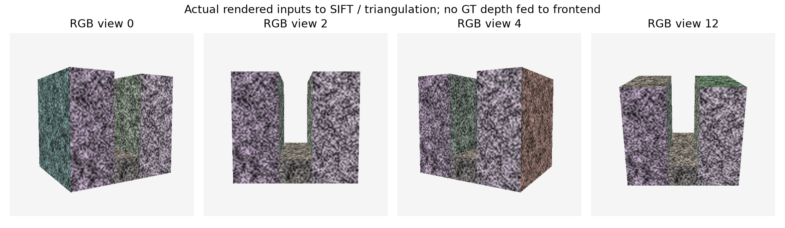
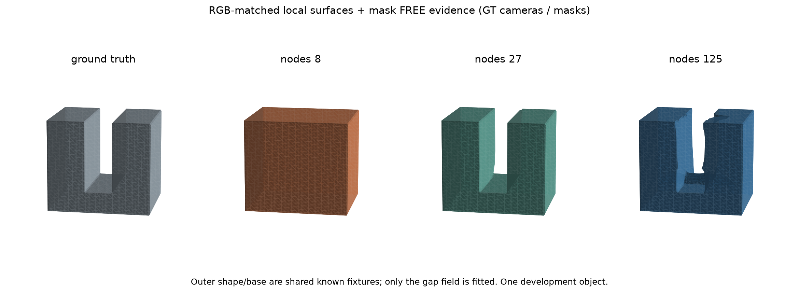

# 合成RGB到局部几何：实际结果与下周一主线

日期：2026-10-20。接续[核心设计](2026-10-19_core_algorithm_proposal.md)、[逐步进度](2026-10-20_MONDAY_PROGRESS.md)。本轮没有制作PPT；优先完成了可运行的机制实验与图像证据接口。

## 1. 结论先行

**今天已经从纯设计推进到两级实际运行：E0有限约束机制实验，以及一个合成RGB对象上的局部重建接口。**当前有可重复的正结果、误雕刻失败、追加观测纠错，以及“更多容量反而更差”的反例。

它足够构成20分钟研究进展报告的实质内容，但还不够证明论文方法有用或新颖。还没有自动选块的独立收益、同容量强基线、真实手机数据、完整对象重建或GPU峰值。

尤其注意：当前合成叉子的缝宽是归一化0.24，物体宽0.9；图像中清晰可见。它测试的是**一个极粗局部单元无法表示相邻两侧表面的机制**，不是毫米级/像素级极细缝恢复。不能把本轮的8/27节点对照包装成先进重建方法之间的性能比较。

## 2. 真正跑过的管线

```text
CPU解析渲染20张512×512带纹理RGB + 已知相机 + GT Mask
    ↓ 前端不读取真值深度、真值法线或真值三维对应
SIFT双向比值匹配 → 已知相机三角化 → 重投影/视差筛选
    ↓
空间去重 → 局部PCA法线 → 固定共享ROI中的表面证据
Mask保守背景投影 → 至少两视图支持的FREE点
    ↓
局部三线性8 / 27 / 125节点的最小违例LP
    ↓
相同约束、相同TV择优求解 → 局部场
    ↓
与各组共享的已知外壳/底座组合 → CPU MC → OBJ
    ↓
独立评价程序才读取解析GT，检查误占据与误雕刻
```

说明：SIFT匹配/三角化是稀疏表面前端，不是完整SfM/MVS；输入相机已知。法线来自匹配点云，向内偏移0.06产生局部实体探针，属于可靠朝向与厚度的假设。ROI手工固定、各组共享；外壳/底座是已知展示结构，不能说整个模型都是从RGB重建的。

实际输入图：



## 3. 先10视图，再补10视图

偶数编号10视图用于初始拟合；奇数10视图用于开发验证。由于此前曾用全部视图调试，**这是开发划分，不是未触碰测试集**。未来必须换独立几何测试，不能沿用此对象宣布泛化。

初始10视图产生16917条通过筛选的跨图像匹配，去重后7664点；对固定局部ROI筛选并抽取160个表面/法线、250个FREE以及160个推断内部探针。另一10视图同样独立提证据。

评价阶段才用GT核查：初始160表面点绝对隐式距离中位数0.000760、P95 0.002502；另一组约0.000717和0.002712。这是归一化单位，不是毫米。两组FREE在该对象上均未落入GT实体，内部探针均在GT实体。这个理想对象不能证明真实数据的可靠性估计已经解决。

### 首次拟合：缝打开了，但会削杆

来源：[初次评价](../experiments/gap_representability/results/rgb_evaluation_v1/metrics.csv)。

| 节点数 | 训练最小违例eta | 缝ROI误占据 | 实体探针保留率 | 中心直通路径 |
|---:|---:|---:|---:|---:|
| 8 | 3.0000 | 100% | 100% | 0/41 |
| 27 | 0.0724 | 0% | 96.75% | 41/41 |
| 125 | 0.0599 | 0% | 95.41% | 41/41 |

开发验证最大归一化违例分别约3、6.00、5.64。不能只看训练最小违例下降：有限点拟合更好，并没有自动满足其他位置的观测。27/125节点都存在误雕刻，独立验证应阻止将这次更新直接当作可靠重建。

### 把另一组观测真正加入后重新拟合

保持旧证据全部不变，追加160表面/250FREE/160内部探针，再重新求解局部场。没有用GT补点，也没有丢弃旧约束；这是局部重拟合，不是优化器状态增量复用或精确回滚。

来源：[追加后评价](../experiments/gap_representability/results/rgb_evaluation_appended_v2/metrics.csv)。

| 节点数 | 合并证据最小违例eta | 缝ROI误占据 | 实体探针保留率 | 中心直通路径 |
|---:|---:|---:|---:|---:|
| 8 | 3.0000 | 100% | 100% | 0/41 |
| 27 | 0.2561 | 0% | 100% | 41/41 |
| 125 | 0.1963 | 0.31% | 99.96% | 38/41 |



27节点不增加容量，只补观测，便在该ROI恢复了被削掉的实体。125节点训练最小违例更低，却仍有局部桥接/波纹，说明继续加自由度不能代替可靠覆盖与拟合约束。训练数据增加以后最优违例可能上升，这并不矛盾：约束集合变多，几何反而可能更真实。

追加后奇数视图已经参与拟合，评价字段明确标记`observation_role=training_replay`；它们不能继续作为留出验证。这里可报告的是独立解析GT上的同对象ROI变化，还不能声称未见视图泛化成功。

## 4. 指标的范围

体积探针采用固定随机种子20261021，在`[.05,.95]×[.34,.84]×[.17,.83]`内采样150000点；缝ROI只取`.39<x<.61`，实体ROI取`x<.36或x>.64`。中心直通是固定`x=.5`、41个z位置、每条151个y样点的全部空域检查。

这些是明确的有限场查询指标。实体保留100%不等于所有Mesh壁厚精确、没有任何边界误差；41条线全通不等于连续拓扑证明。未测完整Chamfer/F-score、法线一致性、最小可恢复缝宽、真实污染率。当前几何整体还包含已知外壳，不能拿整体Chamfer掩盖局部错误。

## 5. 当前算法应如何推进

保留的核心仍是：**先问当前表示能否同时满足可靠空域和表面，再决定重优化、增加容量或暂缓。**今天结果使它必须加上两条纪律：

1. 两层失败不能直接判错误证据，第三层可能成功；使用暂缓/扩窗/继续诊断。
2. 训练最小违例下降不是接受条件；必须检查独立观测、几何完整度和误雕刻。125节点就是现成反例。

当前`eta`阈值只在制造算例中有明确含义。真实图像产生噪声后，不能沿用“必须精确0才可行”来自动分类；需要根据前端误差与场梯度校准容限，冻结开发设置，并记录拒绝/覆盖率。今天没有把0.256临时调成新阈值来宣布自动调度成功。

接下来优先做三件事，而不是再写大模型：

- **独立对象与更窄缝宽扫描。**增加第二种几何，扫描缝宽、投影像素宽、表面纹理和视角覆盖；开发/最终测试按几何划分。先确认强普通方法是否已经解决。
- **同预算简单基线。**视觉外壳/空间雕刻、普通局部网格、均匀/残差选块、只多优化。8节点不是强基线；LP额外时间必须计入，不能仅展示粗细分辨率差异。
- **可靠性和局部边界。**改进独立观测校验、边界条件、稀疏表面支持与法线置信；避免TV或自由节点在未覆盖区产生波纹。然后替换共享解析外壳为实际粗重建场，验证局部拼接。

## 6. 下周一20分钟可讲的实质

建议工作题目：《多视图细结构重建中的误桥：局部表示诊断与观测纠错初探》。这不是最终论文题目。

- 0–3分钟：用RGB输入、封缝Mesh与局部截图明确问题。
- 3–6分钟：信息/表示/优化/提取四类原因；相关工作只解释它们解决哪一类。
- 6–10分钟：粗细最小违例判据、一维线性单元示意、第三层反例。
- 10–15分钟：从真实RGB匹配产生证据的合成实验，展示10视图误雕刻与补10视图纠错。
- 15–18分钟：125节点反例、训练指标与实际几何不一致、已知外壳和GT相机/Mask边界。
- 18–20分钟：独立对象、同预算基线、前端误差校准三个决定去留的实验。

准确措辞是“我实现了一个局部诊断原型，并在受控合成RGB实验中观察到容量和覆盖的不同作用”。不说“首次提出”“已解决细结构重建”“高保真手机扫描系统已完成”。

## 7. 运行与失败记录

- 渲染20图约2.76s；10图前端约1.17s和1.12s；初始局部拟合/导出约1.62s，追加后约1.82s。均为CPU小例单次运行、主程序内计时，不含安装/模块导入，不当严格速度基准。
- SLSQP与OSQP对图像约束上的近最优平滑问题出现未收敛，相关目录保留。最终图像实验统一改用线性TV择优，求解后检查违例不超过最优eta加数值容差。更换的是可行解选择方式，最小违例诊断定义没有改。
- 所有后端均CPU，不存在本次CUDA训练峰值；不能把已查询到RTX3060或其设备占用写成12GB端到端实验。
- 源码、依赖锁、逐阶段输入证据、CSV、OBJ和图均在`experiments/gap_representability/`。最新评价含源码快照和hash。完整重放命令见[RGB运行说明](../experiments/gap_representability/RGB_RUN.md)。

数学与经典工具不是创新声明。所用前端接口参考[OpenCV匹配文档](https://docs.opencv.org/4.x/dc/dc3/tutorial_py_matcher.html)与[标定/三角化文档](https://docs.opencv.org/4.x/d9/d0c/group__calib3d.html)，LP参考[SciPy linprog](https://docs.scipy.org/doc/scipy/reference/generated/scipy.optimize.linprog.html)。研究价值仍需来自合理输入误差下、相同预算的跨对象结果。
