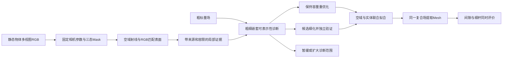

# 一周内把核心想法变成可汇报的实验

更新：2026-10-20。汇报：10月26日，20分钟，无问答。当前状态与数值以[执行进度](2026-10-20_MONDAY_PROGRESS.md)和实验原始文件为准。本文是实施协议，不预先承诺方法有效。

**当天进展：E0已运行完成。**48构造算例、稳定化失败/改善、完整覆盖下8/27节点对照、约束退化消融均已落盘。见[实验及复现](../experiments/gap_representability/README.md)。图像前端、独立场景同预算比较、GPU重建仍未执行。以下E1/E2为后续计划。

**同日继续后的更新：**合成RGB图像前端和局部字段接口也已实际运行，含20张图、10/10开发视图划分与追加观测纠错；见[RGB实测报告](2026-10-20_RGB_INTERFACE_RESULTS.md)。E1只完成单个开发对象的局部接口，不等于完整场景和第一格全套验收；独立几何、同预算选块和GPU重建仍未完成。下表周三的基本数据/接口已有原型，应优先扩展独立几何和缩小缝宽，避免重复搭建。

## 1. 本周只回答一个问题

**同样观察到了空隙和两侧表面，为什么有的区域继续优化就够，有的区域必须增加局部自由度？能否在增加容量之前做出有用的区分？**

候选题目：《面向细结构重建的局部表示能力诊断与自适应细化：初步实验》。这是20分钟进展汇报的工作题目，不是最终学位论文题目。

本周成功的最低标准是“可重复的机制实验 + 一个诚实的失败例 + 可执行的图像接入方案”。更有说服力的目标是：在合成多视图输入上，与相同监督、相同节点预算的简单策略比较。真实物体作为加分项，不让其阻断前两级验收。

不能把同一玩具例从8个节点换成27个节点、结果变好，直接说成自动选块有效。它只能证明这个表示家族的一个容量瓶颈。也不能把精确表面/法线输入的Oracle结果称为RGB重建成功。

## 2. 核心管线与真正需要写的代码



| 模块 | 首版实现 | 最小交付 | 当前状态 |
|---|---|---|---|
| A 数据 | 合成叉形/梳子、孔板，公开确定相机和Mask；后接手机固定物体 | 图像、相机、Mask、GT仅供渲染和评价 | 尚未实现图像集 |
| B 证据 | FREE像素束投至包围盒；表面来自有多视图支持的MVS/三角化 | `evidence.npz`，保留来源和误差 | 当前只有显式标注的解析Oracle |
| C 诊断 | CPU稀疏三线性矩阵、小窗LP、嵌套两层及可选第三层 | `eta_coarse/fine`、求解状态、约束违例 | 已实测48个构造算例及约束消融 |
| D 分配 | 粗可行→重优化；细层改善且验证通过→加节点；其余→暂缓 | 每块理由、增加节点数、时间 | 受控压力测试，未做真实场景选块 |
| E 拟合 | 同一监督、同一目标函数；先冻结相机/外观，不急着写CUDA | 基线与细化场的节点/参数 | 当前LP解仅作机制展示，不是RGB最终优化器 |
| F 提取 | 所有方法先用相同足够细的提取分辨率；后续分块MC | 可加载OBJ/PLY、坐标、接缝检查 | 小CPU体积OBJ已导出并目视核对；流式未实现 |
| G 评价 | 空域通路、误占据、细杆保留；同时计成本 | CSV、图、环境记录、失败例 | Oracle指标已实测，真实评价未做 |

### 证据接口必须先固定

每个点/射线至少保存：`object_xyz / type / view_id / pixel_xy / pose_version / mask_version / confidence / source / tolerance`。表面另存法线、跨视支持数、重投影误差；FREE另存有效射线区间。数据划分需保留`train/select/test`，不能看完最终图再重分测试集。

- `FREE`：确认背景穿过对象包围盒的射线；前方遮挡者后面是`UNKNOWN`，不能直接刻穿。
- `SURFACE`：RGB匹配/MVS给出的估计点，不是传感器深度，不是GT。
- `OBJECT`：像素射线至少应命中目标，不能直接给其整条射线贴“实体”标签。
- `UNKNOWN`：不施加强雕刻；记录缺证据比例。没有表面支持时允许输出“不知道”。

**从Mask无法得到两侧壁的三维位置和厚度。**本周若表面前端未跑通，必须保留“GT表面Oracle”标签；不能偷偷读取GT深度再宣布RGB-only完成。

## 3. 核心算法写到能实现的程度

窗口坐标归一化到`[0,1]^3`，全局物体坐标变换另存。外部正、内部负；节点值可正可负。`g_h(x)=a_h(x)^T z`为三线性标量场，不自动等于真实距离。

对同一批证据、同一容限、同一物理边界，分别解：

```text
eta_h = min eta, eta >= 0
FREE:      A_F z >= delta_F - eta*u_F
SURFACE:  |A_S z| <= eps_S + eta*u_S
NORMAL:    n^T grad g(p) >= gamma - eta*u_N
BOUNDARY: |A_B z - f0| <= eps_B + eta*u_B
```

当前冒烟实验额外采用**Oracle定向表面向内偏移探针**防止删杆；它们不是未经验证就能从普通Mask获得的实体真值。正式接入RGB前，需验证该偏移未跨薄杆/另一面，或用多视表面命中与RGB一致性替代。

`u_F/u_S/u_N`是不同量纲的归一化尺度，必须开发集预定；不能用测试GT调到想要的分类。`eps_S`首先是场值容限，只有对场梯度有约束时才能和位置噪声对应；不能把它直接当毫米误差。节点幅值界也是诊断模型的一部分，应记录并做消融。

粗细空间必须嵌套，细层能精确表示粗层插值。若放开细层边界、换观测或换容限，则`eta`下降不再只说明增加自由度的作用。

| 诊断 | 可做的动作 | 不能推出的结论 |
|---|---|---|
| 粗层低违例 | 保持节点数，重优化或补采样 | 不能保证非线性RGB优化一定收敛 |
| 粗层高、细层低，且独立证据支持改善 | 纳入细化候选，按收益/额外节点成本排序 | 不能保证真实场正确、不能保证连续拓扑 |
| 两层都高 | 暂缓；第三层诊断、扩窗、查边界或输入 | **不能直接判观测错误**，也可能仍不够细 |
| 细层训练低、独立观测差 | 不接受这次候选更新 | 防止细层只是把噪声记住 |

“同一点既要为空又要是表面”是严格矛盾；错位而不重合的噪声可能被高频场拟合，因此LP不是通用异常检测器。有限约束通过后仍需留出视图、梯度/光度检查和Mesh评价。

当前LP的精确可表示性只对应局部显式节点场；不能把它套在任意哈希MLP上，当成那个网络的容量证书。先局部替换为可诊断的标量场，核心为1、外围连续混合且固定边界，再接全局后端。

## 4. 三层证据，逐层升级

### E0：制造解/Oracle机制实验（今天先完成）

输入精确表面、法线、FREE与向内探针。平面、窄缝、同点矛盾、两层不足但第三层可行。求解8/27/125节点的真实3D网格。断言插值精度、梯度、嵌套性、求解后的不等式余量。

验收：分支与数学预期一致；报告阈值敏感性、轴对齐假设、有限点过拟合风险；导出带相同解析外壳的局部Mesh对照。能支持“机制在此有限构造中工作”，不能支持“算法已提高多视重建”。

### E1：图像证据下的最小研究实验（本周优先）

一个带纹理叉形/梳子作为开发对象，一个独立孔板或不同几何作为测试对象；至少3档可成像间隙、记录投影像素宽。先用GT相机和GT Mask，但表面分两支明确报告：Oracle上界与RGB MVS估计。GT Mesh绝不能同时当正常方法的隐性监督。

第一格成功后再做四格：`GT pose + GT mask`、`GT pose + SAM mask`、`noisy pose + GT mask`、`estimated pose + SAM mask`。E0不能占用第一格。周一前未完成的格子标未完成，不能用手工扰动Mask替代真实SAM结果。

必要对照按先后执行：

1. 相同粗场多优化，排除未收敛。
2. 相同粗场提高Mesh提取分辨率，排除仅提取漏缝。
3. 同样FREE/表面监督，粗容量不变，排除仅新增监督。
4. 同节点预算均匀/随机细化、当前残差调度，检验选块价值。
5. 可表示性选块，报告包括CPU LP在内的总耗时。另做等总时间比较，不能把等节点自然说成等时间。

冻结一个开发配置后，至少3随机种子、测试对象不调参。主图不能只放最佳种子，逐场景保留失败。

### E2：真实RGB和12GB闭环（加分但必须诚实）

1个静态、有纹理、非透明反光的桌面叉/梳子/手办，约40–80张、整体与局部有过渡视角。物体保持不动，表面/内壁真实可见。已知尺寸用于标定，不把肉眼照片当毫米GT。

优先跑已有静态摄影测量/MVS；如果它已恢复所有目标间隙，这是对当前课题必要性的挑战，仍必须展示。若部署重建后端半天仍卡在环境，停止扩大安装范围，回到E1与日志。此为执行优先级，不是宣称CPU模型替代真实重建。

分割、位姿/MVS、场训练、局部更新、提取分阶段。小窗LP在CPU，GPU只驻留一个活动块、观测batch与有限优化状态。导出按块分配MC工作区并及时移出顶点；全局结果与缓存留CPU/磁盘。记录每阶段时间、RAM、`torch.cuda.max_memory_allocated/reserved`（适用时）、外部`nvidia-smi`。全部未测阶段标“未测”，不填理论占用充实表格。

## 5. 指标和停止条件

- **必须成对看**：局部空域通路/误桥占据，与每根细杆表面召回/厚度/断裂。只看空域，删除物体就是伪成功。
- 真正场景需有：gap survival、false bridge volume/area、minimum recoverable gap及其投影像素宽、held-out confirmed free-space violation；同时报Chamfer/F-score、normal consistency、完整度、污染率、时间、峰值。没有实现/没有GT就留空，不用简化代理替代名字。
- 当前E0只报告“指定ROI空域误占据率”和“实体探针保留率”；不是完整的上述几何指标集。
- 同预算简单策略同样好→保留工程结果，但不能说判据贡献成立。
- 改善来自削杆→失败；三态丢弃了大部分难例→必须报告覆盖/拒绝率。
- 第三层也失败→既可能证据矛盾，也可能边界、容限、分辨率、模型家族不合适；不能自动升级为异常观测真值。
- 两周内跨几何、同监督同预算无收益，或LP成本抵消收益→停止把“可表示性选块”当论文核心，先诊断，不继续堆模块。

## 6. 10月20日至26日可执行排程

| 日期 | 唯一主要目标 | 当天应落盘的证据 | 止损点 |
|---|---|---|---|
| 周二20日 | E0判据运行、数学/数值检查、反例 | 代码、逐例CSV、场节点、Mesh、失败边界 | 不以安装大型网络替代机制验证 |
| 周三21日 | 建立合成多视图与证据接口 | 2个不同几何、RGB/相机/Mask、像素缝宽、数据划分 | 可见间隙不足先改采集，不调算法 |
| 周四22日 | GT相机/Mask下表面前端与粗场 | MVS结果或明确Oracle支路；粗场误桥及高分辨率提取对照 | 接口未通就缩小ROI，保留失败 |
| 周五23日 | 同预算对照与独立测试 | 多优化/均匀/残差/候选方法CSV；包括LP成本 | 测试前冻结设置，简单方法赢也报告 |
| 周六24日 | 一个真实例或扰动/失效实验 | 真实截图/OBJ或噪声曲线、阶段资源记录 | 当晚冻结结论，不再换后端 |
| 周日25日 | 整理20分钟证据故事与讲稿 | 5张关键图、结论能说/不能说、离线演示备份 | 不依赖现场网络/临时训练 |
| 周一26日 | 讲清研究问题和已知边界 | 使用周日冻结文件 | 不临场升级实验结论 |

“本周完成”的承诺只覆盖可控E0和执行协议；E1/E2以实际运行与结果验收，不保证一周内证明论文价值。无需服务器即可做E0/小规模E1；服务器只在更大对象/更多强基线确有需求时申请，不视为默认资源。

## 7. 20分钟应该讲什么（内容路线，不是制作PPT）

| 分钟 | 要讲的内容 | 必须拿出的东西 |
|---|---|---|
| 0–3 | 可见的空隙为何被封住；为什么整体漂亮不够 | GT与误桥Mesh、局部截面 |
| 3–6 | 把问题拆成信息、表示、优化、提取；相关工作只讲机制位置 | 一张故障归因图，3项最接近机制 |
| 6–11 | 空域与邻接表面兼容性；粗细比较；三种动作 | 线性单元反例、核心公式和第三层反例 |
| 11–16 | 本周真实完成的实验和成本 | 原始CSV导出的图、对照Mesh、相同监督说明 |
| 16–18 | 哪里还会错；Oracle不等于RGB；均匀细化可能已经够 | 一个失败/不确定例，未完成项明确列出 |
| 18–20 | 接下来用什么实验决定保留还是淘汰 | E1/E2协议与具体停止条件 |

目前能稳妥说的是“实现了一个有限约束诊断原型，并检验其机制/局限”（需运行完成后使用）。不能说“已解决高保真RGB扫描”“保证不误桥”“方法首次提出”“完整流程已在12GB验证”。学校允许科研创新思路交流；用户的20分钟无问答形式不改变证据标准。

来源核查：本地`nextmonday`培养方案第6–7页；[2026学术月官方通知](https://yjs.nwu.edu.cn/info/1123/5641.htm)；[软件工程083500培养方案](https://cs.nwu.edu.cn/info/1051/1769.htm)。学校材料要求与现场安排分开记：本地方案有“提交论文”，具体格式按院内通知；学校报告审核要求不等于现场一定有教师出席。
